# Request for comments: A claims-based tool for docs accuracy

**Owner:** Vincent Ge

> [!NOTE]
> **This RFC is a partial solution to get incrementally better, rather than the whole fix.** The full fix takes generated references, PR-driven maintenance like John's work on Knowledge Writer, occasional spring cleaning, and evals over these facts. We'll also need future work to design docs for agents and move conceptual `/learn` content out for humans.
>
> **PoC results aren't final.** Every number, mapping, and screenshot in this RFC and its addendums tests whether the concept is valuable, rather than whether it's production-ready. Solid numbers and mappings still need:
> - **All SDKs and services indexed.** PostHog products intersect across repo and product boundaries, so partial indexes miss real behavior.
> - **Crawling, splitting, and mapping fixed.** All three stages still have remaining bugs.
> - **Retrieval, extraction, and verification optimized.** Each still needs substantial work.

**Contents:**

- [1. Problem statement](#1-problem-statement)
- [2. Proposed solution](#2-proposed-solution)
  - [2.1 Why direct code-to-docs tracing breaks](#21-why-direct-code-to-docs-tracing-breaks)
  - [2.2 Trade-off: the abstraction layer](#22-trade-off-the-abstraction-layer)
- [3. A strict coded system](#3-a-strict-coded-system)
  - [3.1 Build pipeline](#31-build-pipeline)
  - [3.2 Trade-off: deep non-user-facing logic and async artifacts](#32-trade-off-deep-non-user-facing-logic-and-async-artifacts)
  - [3.3 Known gap: feature flags and enclosing gates](#33-known-gap-feature-flags-and-enclosing-gates)
  - [3.4 Trade-off: LLM extraction cost and non-determinism](#34-trade-off-llm-extraction-cost-and-non-determinism)
- [4. Docs mapping](#4-docs-mapping)
  - [4.1 Where these files live](#41-where-these-files-live)
  - [4.2 Known gap: docs completeness metrics](#42-known-gap-docs-completeness-metrics)
  - [4.3 Known gap: visual media, runtime UI, and external claims](#43-known-gap-visual-media-runtime-ui-and-external-claims)
  - [4.4 Known gap: writing human-friendly, well-abstracted docs](#44-known-gap-writing-human-friendly-well-abstracted-docs)
- [5. Drift, lifecycle, and audit trails](#5-drift-lifecycle-and-audit-trails)
  - [5.1 Integration with Knowledge Writer](#51-integration-with-knowledge-writer)
  - [5.2 Renames, deletions, and why nothing gets thrown out](#52-renames-deletions-and-why-nothing-gets-thrown-out)
  - [5.3 Trade-off: manual grooming on edge cases](#53-trade-off-manual-grooming-on-edge-cases)
  - [5.4 Known gap: net-new features and silent omissions](#54-known-gap-net-new-features-and-silent-omissions)
  - [5.5 Trade-off: cross-repo pin lag and append-only register growth](#55-trade-off-cross-repo-pin-lag-and-append-only-register-growth)
- [6. Downstream: lean, ugly agent skills](#6-downstream-lean-ugly-agent-skills)
  - [6.1 Trade-off: ugly skills aren't human-readable and still need tight slicing](#61-trade-off-ugly-skills-arent-human-readable-and-still-need-tight-slicing)
- [7. Orthogonal concept tags](#7-orthogonal-concept-tags)
  - [7.1 Known gap: tag taxonomy drift and cross-product ownership](#71-known-gap-tag-taxonomy-drift-and-cross-product-ownership)
- [8. Success criteria](#8-success-criteria)
  - [8.1 Early signal: controlled `flash` A/B test](#81-early-signal-controlled-flash-ab-test)
  - [8.2 Early signal: 8-week stateful PR maintenance replay (`mcp-analytics`)](#82-early-signal-8-week-stateful-pr-maintenance-replay-mcp-analytics)
- [9. Scope and Phase 1 payoff](#9-scope-and-phase-1-payoff)
  - [9.1 Out of scope for Phase 1](#91-out-of-scope-for-phase-1)
- [10. Alternatives considered](#10-alternatives-considered)
- [11. POC addendums](#11-poc-addendums)

## 1. Problem statement

Agents complete point fixes and small fixes for docs very well. Without clear rules, process, and workflows to guide them, they lack a comprehensive set of guardrails for three things:

- Producing accurate claims against code without assumption.
- Mapping those claims to docs and book keep this information.
- Letting other agents easily trace back later whether a claim is still accurate.

We've tried Inkeep. Of course, before it exploded when we introduced Trunk.io merge queues (shoutout to my friends at Trunk), it still had problems.

- We don't know to which commit/version of the monorepo, a piece of docs is accurate.
- Inkeep did a poor job updating related facts when the artifact doesn't turn up by grepping.
- Inkeep did a poor job maintaining page and style guidelines. It doesn't know about the deliberate decisions made by other people/agents before. Introducing thrash.

A good example of a real miss by Inkeep, because the association of behavior is very convoluted.

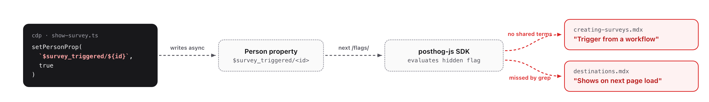

The goal here:

- More rigorous accounting of docs.
- Better coverage and accuracy of docs.
- Catch more docs drift without using Fable on max effort ;)
- Reduce the effort and amount of backtracing needed by an agent to handle PRs.
- **Tangent:** A way to piece together agent skills without the heavy abstractions of human docs.

This RFC aims to discuss some directions to _experiment_ with to resolve these problems.

## 2. Proposed solution

As writers, we gather fact we know about PostHog, then map it to a mental model in our heads, finally translating it to docs. Good writers have a mental mapping and track decisions made along the process. In fact, we frequently discuss past decisions of this type in [PRs like this one](https://github.com/PostHog/posthog.com/pull/11999).

Robots need the same thing:

1. **Derived knowledge.** Keep a library of coded facts, procedures, and use cases pinned to source lines. Knowing which product, service, and code lines justify which fact about the product.
2. **Docs mapping.** Docs are how we choose to represent a set of facts in writing. Often we introduce structural fillers, choose to present certain facts first, earlier than they may come in the flow, and deliberately put emphasis on certain features while removing others entirely.

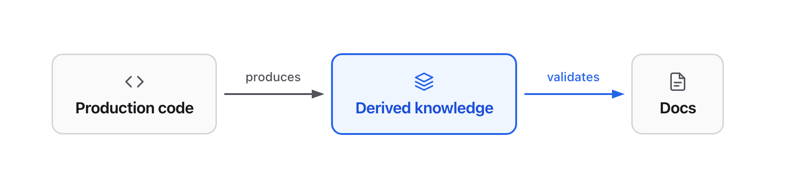

### 2.1 Why direct code-to-docs tracing breaks

Human docs describe what a user sees rather than how the code works. An agent reading a PR can't work backwards from that abstraction to guess which docs pages need updates. _(Well it can, but it needs to read and blame extensively to rebuild a mental model of why the docs are the way they are today)._

Four Surveys examples show how the mapping breaks:

**Example 1 (Easy): direct 1-to-1 match.** Same terms, one page. A normal PR agent catches this.

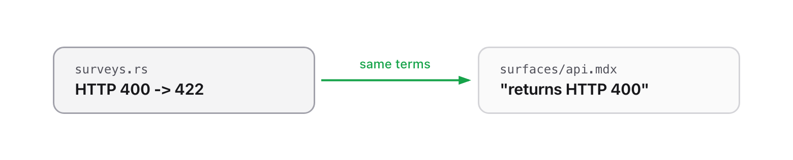

**Example 2 (Medium): cross-SDK fan-out.** A `minSdk = 23` bump in `posthog-android` hits Android docs and the support matrix. Flutter wraps the Android SDK, so it hits `installation/flutter.mdx` too.

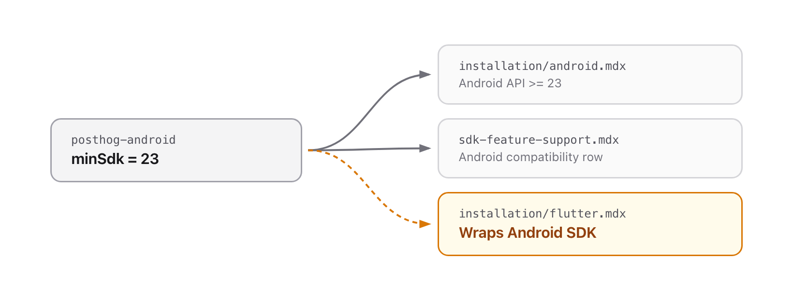

**Example 3 (Hard): one flag, four unrelated symptoms.** A `posthog-js` change to `$survey_completed: false` and `$survey_submission_id` on partial sends hits Slack notification deduplication, billing copy, URL prefill, and response counts. Those pages don't share wording, so an agent without a map has to read all of them to catch all four.

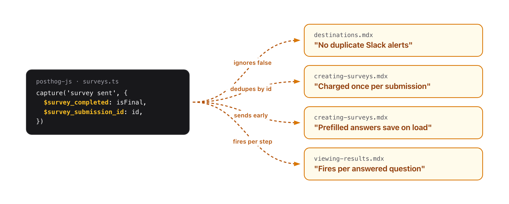

**Example 4 (Hardest): async hops with no imports.** No import links a Workflows `Show survey` template to the client SDK. The behavior hops through an async person property (`$survey_triggered/<id>`) and a hidden targeting flag before hitting multiple docs pages.


In our [Surveys IA](https://docs-coverage.hosthog.dev/#tool/surveys?tab=surfaces), three code-pinned facts plus the [docs map](https://docs-coverage.hosthog.dev/#tool/surveys?tab=docs) let an agent walk this chain without grepping prose:

- **[`SV-API-F-0005`](https://docs-coverage.hosthog.dev/#tool/surveys?tab=graph&q=SV-API-F-0005) (CDP template):** `posthog-show-survey.template.ts` emits a `$set` event writing `$survey_triggered/<survey_id>: true` (port `store:write:person_prop:$survey_triggered/{}`).
- **[`SV-UI-F-2145`](https://docs-coverage.hosthog.dev/#tool/surveys?tab=graph&q=SV-UI-F-2145) (Targeting filter):** `workflowSurveyTargeting.ts` builds the survey's `targeting_flag` rule requiring person property `$survey_triggered/<survey.id>` `is_set`.
- **[`SV-WEB-F-0115`](https://docs-coverage.hosthog.dev/#tool/surveys?tab=graph&q=SV-WEB-F-0115) (Client SDK):** `surveys-renderer.tsx` blocks the survey until `targeting_flag_key` is enabled on the next `/flags/` refresh.
- **Docs claims:** [`creating-surveys.mdx`](https://docs-coverage.hosthog.dev/#tool/surveys?tab=docs&q=creating-surveys) and [`destinations.mdx`](https://docs-coverage.hosthog.dev/#tool/surveys?tab=docs&q=destinations) bind to these facts, so editing the CDP template flags both pages.

### 2.2 Trade-off: the abstraction layer

You can't reproduce 100% of user-facing code logic on a codebase this size. A 100% faithful copy is just the codebase itself.

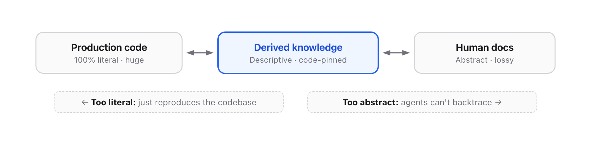

Derived knowledge sits in the middle. It's far smaller than raw source code, yet more concrete and complete than human docs, so cheap models can verify claims.

## 3. A strict coded system

Edwin keeps talking about dewey decimal system and FAA manuals so I took some inspiration lol.

Every atomic entry in the middle layer gets a permanent, surface-scoped address:

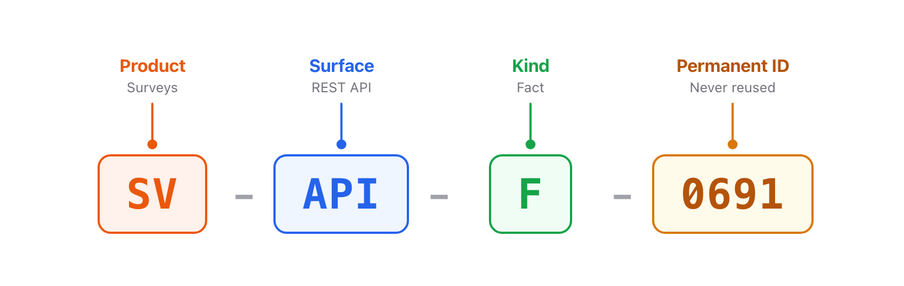

- **Product (`SV`).** Closed tool code (`SV` Surveys, `PA` Analytics, `FF` Flags, `SR` Replay).
- **Surface (`API`).** Where the user acts (`UI`, `API`, `MCP`, `WEB`, `RN`, `IOS`, `AND`, `FLT`, or `ALL` for cross-surface rules).
- **Kind (`F`).** One of five leaf types: `P` prerequisite, `F` atomic fact, `PR` 1-surface procedure, `C` docs claim, or `D` editorial decision.
- **Permanent ID (`0691`).** Minted once in an [append-only register](https://github.com/PostHog/context-mill/pull/571/files#diff-8a974971c69dec8c725d49400eaf27711024324b87e2e06d5d3c37938e9d1fdeR1-R80) (`surveys.codes.json`) and never reused, so links in PR reviews, docs maps, and skills survive rewrites. The prototype used 4-digit padding on `F`/`C` and 2-digit on `P`/`PR`/`D`, which fills up fast, so widening new IDs to 6 and 4 digits avoids collisions without breaking existing links.

Grouping codes stay cross-surface at the product level, with no per-SDK chapters. Chapters (`SV-0..N`), capability sections (`SV-x.y`), and use cases (`UC-1..K`) organize features across every surface rather than duplicating chapters per SDK.

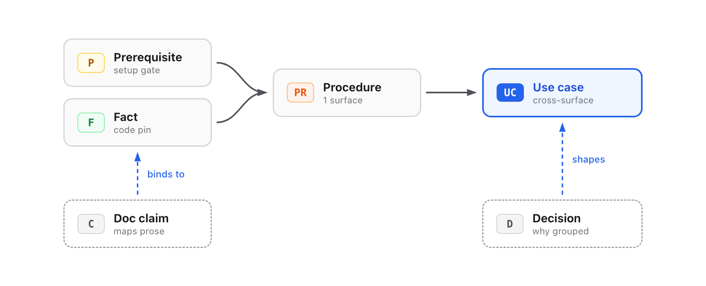

### 3.1 Build pipeline

The pipeline pairs deterministic scripts with small agent passes (details in [Addendum 4](addendum-04-flash-ab-and-pipeline.md)):

1. **Index code and manifests.** Tree-sitter walks in-scope repos (`posthog`, SDKs, MCP) and YAML manifests. It pins each symbol to a `repo commit` and a separate `function md5` hash ([`pin.mjs`](https://github.com/PostHog/context-mill/pull/571/files#diff-7d85dee2f022ad11c4da00cc14b60b81c9671b75da4fe05e08b21ec0506b1129R63-R158)). Functions over 500 lines split into overlapping 380-line windows ([`ast-pins.mjs`](https://github.com/PostHog/context-mill/pull/572/files#diff-5f1ea55bdd899876582fb34cf30d82044d95a46613cb5ca0cb24ed710835e877R11-R15)) so big files don't drop behavior.
2. **Extract facts and ports.** Small agent batches read symbol slices and emit atomic `F` facts with verbatim code quotes and cross-boundary ports ([`fact.mjs`](https://github.com/PostHog/context-mill/pull/571/files#diff-998b92e84132d82ce681160710626875fa7bb6d29e3373a0eea37e2ef808fe1aR5-R32)). Docs files are quarantined so docs can't prove themselves.
3. **Wire internal ports and platform seams.** A deterministic script (0 LLM calls, [`port-linker.mjs`](https://github.com/PostHog/context-mill/pull/572/files#diff-0984c6dfad27fa5f78b0242f3ba291addb0df12ec9642bba6eedb1713fe95486R28-R76)) links internal callers to handlers across events, HTTP paths, and model hooks. A small agent pass maps cross-team calls onto pinned `platform-*` seams (`flags`, `cdp`, `capture`, `ingestion`, `hypercache`, `mcp`) rather than crawling the whole monorepo.
4. **Assemble procedures and mint IDs.** One pass chains `P` and `F` into 1-surface procedures (`PR`), and scripts verify every citation ([`build-ia.workflow.mjs`](https://github.com/PostHog/context-mill/pull/573/files#diff-228a8ea8774b4239920ec3619f3987b3440c11c3dc45bcc50a5c71afe64e70a8R244-R305)). Use cases (`UC`) then group those procedures across surfaces, and new codes append to `<product>.codes.json`.

### 3.2 Trade-off: deep non-user-facing logic and async artifacts

Internal systems like CDP templates, ingestion pipelines, and hidden flags still affect users through async artifacts like `$survey_triggered/<id>`. Crawling the whole monorepo to follow every internal hop won't scale.

We stop at pinned `platform-*` seams and link across them by artifact key. That keeps the graph small, though upstream contract changes need seam checks to avoid silent drift.

### 3.3 Known gap: feature flags and enclosing gates

Feature flags are left out of the IA on purpose for now. Anything behind a flag is treated as not shipped yet. It gets no facts and no docs until the flag is removed, because the experiment isn't done and the behavior can still change. We could build the IA per flag state. The hard part is partial rollouts: we'd have to decide which version of the docs to serve based on which version of the flag a reader gets. That's possible, but it's a much bigger problem than this RFC needs to solve, so we'll deal with it later.

The IA doesn't work with feature flags today, though it has real potential. Facts already pin to verbatim quotes and cross-surface connectors, including flag checks. Each fact can carry its **enclosing gate**: feature flags, `is_cloud()`, org AI approval, required scopes, `package.json` `exports` subpaths, and SDK version floors. Any flag change or removal then lets us trace affected facts and downstream doc bugs straight upwards.

### 3.4 Trade-off: LLM extraction cost and non-determinism

Initial crawling still relies on small LLM passes over code slices. Verbatim-quote checks block hallucinations, but extractors can still miss implicit behavior, split one rule into noisy facts, or phrase the same behavior differently across runs.

> [!WARNING]
> **Don't write docs straight from raw `master`/`HEAD` facts.** They don't account for feature flags or Cloud-only and org-AI gates yet, so you'll publish unreleased or gated UI as GA. That blew up on the Surveys stack with Show survey, Translations, hosted canvas, and AI summaries. Treat facts as a coverage checklist and run a bounded recrawl of live source and published SDKs before writing.

## 4. Docs mapping

The docs mapping connects derived facts to live `posthog.com` pages without making human docs mirror the codebase.

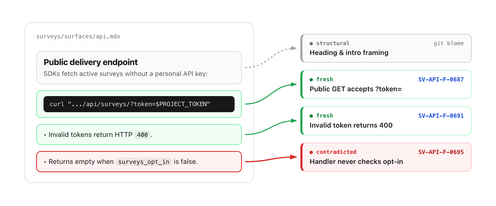

- **Split MDX into pieces.** Break down the source MDX (including imported snippets and SDK tabs) into chunks: headings, intro prose, paragraphs, list items, code blocks, and screenshots ([`mdx-splitter.mjs`](https://github.com/PostHog/context-mill/pull/572/files#diff-d1c840d6536e9a4053653e2a35cbd11aa84cd48011de51c2c18df6f4a1ba18c6R1-R80), [`map-docs.workflow.mjs`](https://github.com/PostHog/context-mill/pull/573/files#diff-2a6b71086f2444cb098c3284c970146468a42b400cdc94096e69d92bf4cdb61eR1-R55)).
- **Separate framing from checkable claims.** Headings and intro copy stay `structural` (manual-only) so the tool won't nag about style. Checkable claims bind to code-pinned `F` facts (`fresh`, `stale`, `contradicted`, `unbound`), and screenshots default to `unverified`.
- **Keep editorial decisions (`SV-ALL-D-*`).** Each section can link a decision code explaining why it's organized that way (like combining SDKs or hiding internal plumbing), so agents don't undo it during point fixes.
- **Verify contradictions before flagging.** Any `contradicted` or `unbound` claim goes to a second-pass judge that reads the full symbol slice first. Coverage also walks 1-hop port links, so a documented UI or API step credits the backend validator behind it.

Each bound fact traces through its detached `repo commit` and `function md5` pin to exact lines of production code:

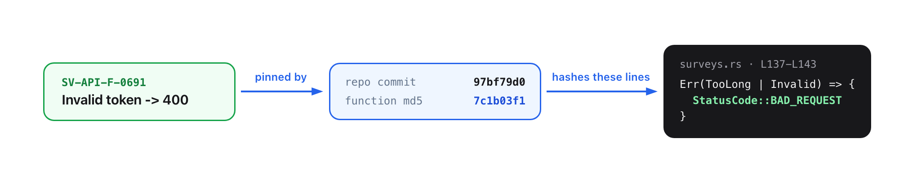

### 4.1 Where these files live

Everything lives in `context-mill` under `facts/`, while live docs stay in `posthog.com`:

```text
context-mill/
└── facts/
    ├── repos.yml                       # Pinned commits per source repo
    ├── registries.yml                  # Closed lists of tools, surfaces, and tags
    ├── products/
    │   └── surveys.yml                 # Per-product surface rules, repo prefixes, and exclusions
    ├── registers/
    │   └── surveys.codes.json          # Append-only permanent Dewey code register and tombstones
    ├── tools/
    │   └── surveys.json                # Pinned anchors, facts, ports, prereqs, 1-surface procedures, and use cases
    └── docs-coverage/
        └── surveys.json                # Chapters, sections, decisions, overlapping claims, and coverage
```

### 4.2 Known gap: docs completeness metrics

Docs completeness metrics help spot missing surfaces and blind spots, rather than chasing 100%. Internal helpers, non-public code paths, and `unverified` screenshots skew the denominator.

One-hop port reach also only approximates what a reader actually needs to know.

### 4.3 Known gap: visual media, runtime UI, and external claims

Screenshots, videos, interactive embeds, and third-party vendor claims can't be checked from source code alone. They sit `unverified` until checked manually or against a live instance, and dynamically generated MDX components can hide claims from static parsing.

### 4.4 Known gap: writing human-friendly, well-abstracted docs

We still haven't solved producing human-friendly, well-abstracted docs. The more we push agents to write at higher levels of abstraction, the worse they perform. Agents love verbosity and can't grasp why humans work with high levels of abstraction. Oddly, that's also why the ugly skills in Section 6 work at all.

## 5. Drift, lifecycle, and audit trails

You don't need to check `master` on every PR. `repo commit` is detached from `function md5`, so refresh runs as a two-stage filter ([`refresh-drift.workflow.mjs`](https://github.com/PostHog/context-mill/pull/573/files#diff-b21b26dfc2761f5ce687cf9821718340fe887f79402a25c86235aa349d921da0R19-R107)):

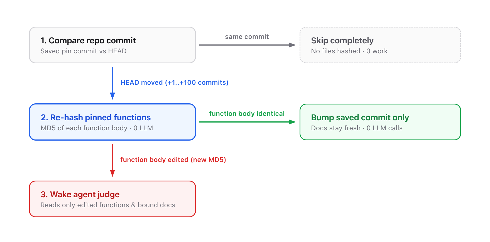

1. **Outer gate (repo commit).** If `HEAD` hasn't moved since the last pin, nothing hashes.
2. **Inner check (function body MD5, 0 LLM calls).** Even if `master` moved 1, 15, or 100 commits, a script re-hashes every pinned function body in milliseconds. Unchanged functions bump their saved commit SHA and stay `fresh` with zero LLM calls.
3. **Judge pass.** Only functions whose body MD5 changed wake an agent judge. The IA links `symbol -> F -> PR -> UC -> C`, so tracing what's affected is cheap. Behavior-preserving refactors update the pin with no docs PR (11 of 16 changed claims in an 11-day AI Observability replay). Real behavior changes flip the exact doc line to `contradicted`.

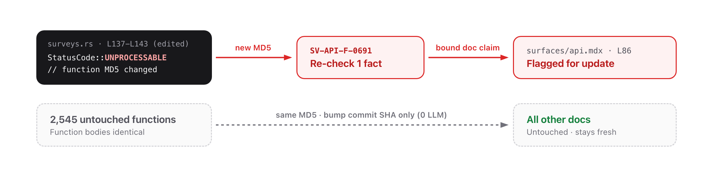

**PoC note:** These replay and blast-radius numbers are early checks, rather than final metrics. Full SDK indexing, crawling and mapping bug fixes, and verification tuning will still shift them.

Most code doesn't change between PRs, so only modified hashes plus new or removed exports wake an agent pass.

For direct human `.mdx` edits, a text-matching script re-anchors unchanged claims and marks edited lines `unverified_human` rather than blocking PRs.

### 5.1 Integration with Knowledge Writer

Rather than running two separate maintenance loops, Phase 2 would integrate this with `products/knowledge_writer`:

- **Better blast-radius input for `merge_check`.** Today, Knowledge Writer reads a raw PR diff and sitemap URLs to guess which pages need updates. Our deterministic `symbol -> F -> C -> page` graph will let `merge_check` catch cross-SDK and indirect symptom pages (Examples 2 to 4) without scanning the whole docs tree.
- **Shared claim tools to maintain the IA.** Knowledge Writer will use the same [pointing-and-calling](addendum-04-flash-ab-and-pipeline.md#2-pointing-and-calling-shisa-kanko) claim tools and checklists to update stale IA facts alongside `.mdx` edits on merged PRs.
- **Phase 2 integration work.** Before wiring them together, we'll settle IA file location (`context-mill/facts/` vs `posthog.com`), `KNOWLEDGE_WRITER_DOCS_PATHS` allowlists, and how `grounding.py` validates JSON/YAML vs Markdown.

### 5.2 Renames, deletions, and why nothing gets thrown out

Knowledge doesn't only grow. Features get renamed, deleted, or sunset:

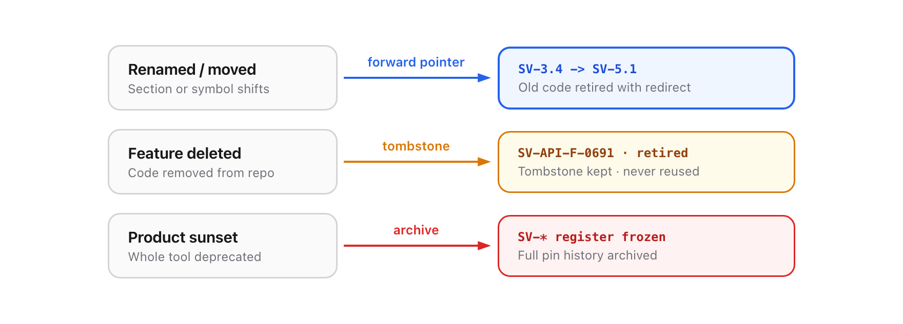

Retired codes stay in the register rather than getting overwritten or deleted. That gives agents an audit trail `git blame` can't provide:

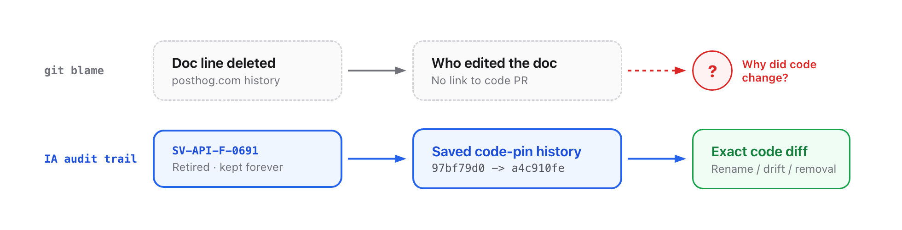

`git blame` on a deleted doc line only shows who edited `posthog.com` and when. Retired IA codes keep their pin commit history, so a later agent traces a missing caveat back to the exact code rename, drift, or removal.

### 5.3 Trade-off: manual grooming on edge cases

We still expect occasional manual grooming when abstractions shift or tricky drift slips through. That's still far cheaper than periodic full recrawls.

### 5.4 Known gap: net-new features and silent omissions

Commit and MD5 checks only fire when existing pinned functions change. They catch stale claims fast, but they won't notice a brand-new feature, a new SDK method, or a missing doc page on their own. Catching net-new additions still depends on PR-level discovery and new-export indexing.

### 5.5 Trade-off: cross-repo pin lag and append-only register growth

Pinning across 5+ repos (`posthog`, SDKs, `posthog.com`) means pins lag behind `master` between syncs. Append-only registers (`*.codes.json`) also grow forever with tombstones and forward pointers, adding file size and review surface in `context-mill`.

## 6. Downstream: lean, ugly agent skills

The same coded middle layer compiles straight into standalone one-pager skills ([`UC-1..UC-15`](https://docs-coverage.hosthog.dev/#tool/surveys?tab=use-cases), [`skill-compiler.mjs`](https://github.com/PostHog/context-mill/pull/572/files#diff-a2bcce37913af5adf652dfcbb9f42cc856f2618b5978d2480ce8a79f046ab34eR1-R80), [`compile-skills.workflow.mjs`](https://github.com/PostHog/context-mill/pull/573/files#diff-c0fcee28de6bf449b5c31a125f654b5f37af0988472bf511be5f4dbfe13a31b4R43-R60)) without passing through human docs.

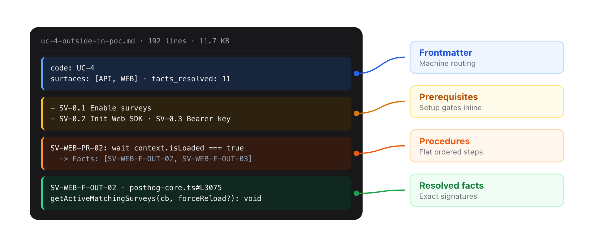

A compiled skill (`uc-4-outside-in-poc.md`) is miserable for humans to read. It drops narrative flow and progressive disclosure, repeats prerequisites inline, and dumps raw codes, paths, and function signatures onto the page.

Agents don't need human abstraction layers. One file with the flat `P -> PR -> F` graph and exact signatures lets an agent build the flow on the first try.

In a blinded zero-hint Devbox test, an agent completed [`UC-4`](https://docs-coverage.hosthog.dev/#tool/surveys?tab=use-cases&q=UC-4) (custom survey UI + REST API launch + event capture) in **4 turns with 0 retries**.

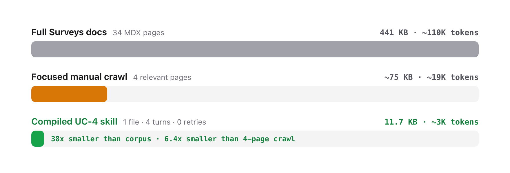

A surface-sliced skill (`11.7 KB`) cuts context by **97.3% (38x)** vs the 34-page Surveys corpus (`441 KB`) and **6.4x** vs a 4-page crawl (`~75 KB`). Setup prerequisites stay inline, so agents don't hunt across pages.

Every `UC-*` skill is self-contained and runnable, so we can test docs against live PostHog instances. Five blinded Devbox runs ([`UC-1`](https://docs-coverage.hosthog.dev/#tool/surveys?tab=use-cases&q=UC-1), [`UC-3`](https://docs-coverage.hosthog.dev/#tool/surveys?tab=use-cases&q=UC-3), [`UC-4`](https://docs-coverage.hosthog.dev/#tool/surveys?tab=use-cases&q=UC-4), [`UC-5`](https://docs-coverage.hosthog.dev/#tool/surveys?tab=use-cases&q=UC-5) + [`UC-12`](https://docs-coverage.hosthog.dev/#tool/surveys?tab=use-cases&q=UC-12), and [`UC-8`](https://docs-coverage.hosthog.dev/#tool/surveys?tab=use-cases&q=UC-8)) caught real extractor and docs gaps before anything shipped ([Addendum 1](addendum-01-live-skill-tests.md)).

**PoC note:** These Devbox runs and size ratios aren't final. Partial repo indexes, crawling and splitting bugs, and rough extraction still limit the compiled skills.

### 6.1 Trade-off: ugly skills aren't human-readable and still need tight slicing

Compiled skills trade human readability for token efficiency, so they can't replace human docs. Unsliced 8-surface dumps also bloat to `4,407` to `9,170` lines ([Addendum 1](addendum-01-live-skill-tests.md), [Addendum 3](addendum-03-dewey-catalog-and-pipeline.md)), so agents need surface-sliced skills by default.

## 7. Orthogonal concept tags

The [base catalog](https://docs-coverage.hosthog.dev/#tool/surveys?tab=surfaces) groups facts by product (`SV`, `PA`, `FF`, `SR`) and surface ([`WEB`](https://docs-coverage.hosthog.dev/#tool/surveys?tab=graph&surface=sdk%3Aweb), [`IOS`](https://docs-coverage.hosthog.dev/#tool/surveys?tab=graph&surface=sdk%3Aios), [`AND`](https://docs-coverage.hosthog.dev/#tool/surveys?tab=graph&surface=sdk%3Aandroid), [`API`](https://docs-coverage.hosthog.dev/#tool/surveys?tab=graph&surface=api)).

Developer tasks often cut across products on one concept, like `identify` or `capture`. `identify()` on iOS touches four doc trees at once: Product Analytics (`distinct_id` merging), Feature Flags (automatic flag reload), Surveys (targeting re-evaluation), and Session Replay (linking pre-login recordings).

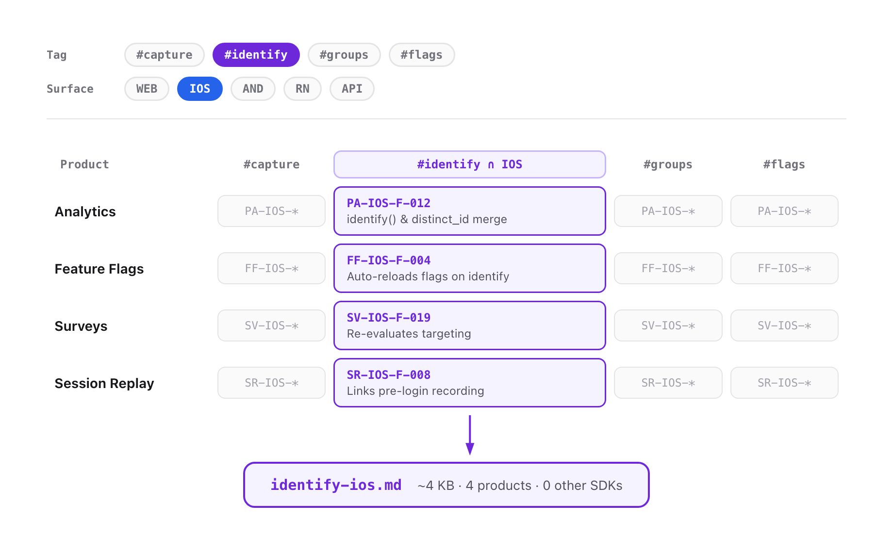

Concept tags (`#capture`, `#identify`, `#groups`, `#flags`) attach to already-pinned facts with zero extra code crawling. One tag intersected with one surface (`#identify ∩ IOS`) compiles a ~`4 KB` cross-product skill with no Web, Python, or Android noise.

### 7.1 Known gap: tag taxonomy drift and cross-product ownership

Concept tags cut across multiple teams and repos. Without strict curation, tags sprawl or drift in meaning across products, and cross-product tag accuracy has no single team owner.

## 8. Success criteria

From basic tooling up to the hardest goals, here's what we hope to accomplish:

1. **Tools to help catch holes in docs.** Spot missing surfaces, SDK parity gaps, and direct contradictions against production code before readers hit them.
2. **Provide docs completeness metrics.** Measure coverage and accuracy across products and surfaces to highlight blind spots (while accepting the metric gaps noted in Section 4.2).
3. **Cut agent backtracing on PRs and audits.** Let cheaper models jump straight from a code diff to affected facts and doc lines instead of grepping dozens of files or burning max-effort Fable.
4. **Catch indirect and async docs drift continuously.** Keep the IA and live docs accurate as code moves, including cross-SDK fan-out and async artifact chains, without periodic full recrawls.
5. **Compile lean, runnable agent skills from the same layer.** Generate surface-sliced and tag-sliced skills straight from pinned facts without human-docs abstractions, and verify them against live instances.

### 8.1 Early signal: controlled `flash` A/B test

Two identical read-only `flash` agents ran the same 3-part Surveys audit against `posthog.com` docs ([Addendum 4](addendum-04-flash-ab-and-pipeline.md)):

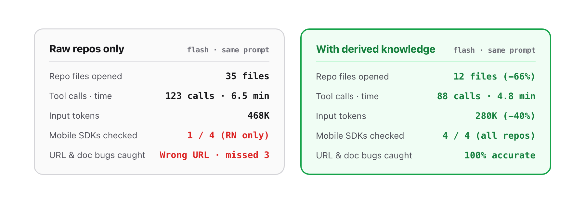

- **Raw repos only:** Opened **35 files** across **123 tool calls** (`468K` tokens, `6.5 min`). Missed the `posthogsurveys.com` domain bug, **3 of 4 mobile SDKs**, 3 affected doc files, and 2 existing bugs.
- **With derived knowledge:** Opened **66% fewer files (`12`)**, used **40% fewer tokens (`280K`)**, and finished **25% faster (`4.8 min`)**. Caught all 4 mobile SDKs, every affected page, and every existing bug.
- **Remaining gap:** Still spent 33 turns querying raw `1.1 MB` JSON files with ad-hoc scripts. We now build a zero-dep local `facts.sqlite` index ([`facts-sqlite.mjs`](https://github.com/PostHog/context-mill/pull/572/files#diff-044c31dcaebddc012161de680118fdf2b280a040e47775a06829a350dab2dfd9)) alongside the files using SQLite FTS5 BM25 (`140.8ms` 5,000-fact roundtrip, `2.89ms/query`).

**PoC note:** This single A/B run isn't a final benchmark. The numbers come from a partial index with unfixed mapping bugs and untuned retrieval and verification.

### 8.2 Early signal: 8-week stateful PR maintenance replay (`mcp-analytics`)

Two Claude Code SDK agents (`claude-sonnet-5-5`, medium effort) maintained real copies of `contents/docs/mcp-analytics/*.mdx` across **8 weeks of history**, from October 3 to November 23, 2026 ([Addendum 5](addendum-05-claude-sdk-agent-repro.md), [`stateful-ia-engine.mjs`](https://github.com/PostHog/context-mill/pull/574/files#diff-f4ad5aa6d6e9e0201122bb7cbbef5d1c7d6a00d4a6ca17ed59ba63ce5f1eeaa5R1-R50), [`stateful-8wk-benchmark.mjs`](https://github.com/PostHog/context-mill/pull/574/files#diff-dd4fbd2b06a12b23d36e0144d882dcf24321c95bd6ec6f47f3221ed25e12da60R1-R50), [`stateful-8wk-scorecard.json`](https://github.com/PostHog/context-mill/pull/575/files#diff-78497f8e6fb63b80d36a37600eac9ffe1661e543ca594329a170b931f7d30eb4R1-R50)). They replayed `46` real code PRs, `3` real human docs PRs, and `4` planted hard PRs in order, and each carried its own edits forward:

- **Higher accuracy, half the false positives.** Read/write IA tools and a 4-step decision tree raised PR decision accuracy from `82.0%` to **`90.0%`** (`F1` `0.862` to **`0.918`**). False-positive PRs dropped in half (`8` to **`4`**), edited-page F1 rose from `0.716` to **`0.776`**, and open doc drift fell from `15` to **`11`**.
- **Self-maintained IA over two months.** On October 3, the IA had `0` WebMCP and `0` Rust SDK facts. The agent updated `74` facts, retired `43` with tombstones, mapped `56` new ones (including both brand-new surfaces), and updated or minted `76` claim bindings. It deferred `2` unreleased feature flags and reconciled all `3` human docs PRs, both with `0` LLM calls.
- **Caveats and remaining gaps.** Both arms ran Sonnet on medium effort (`claude-sonnet-5-5`). Opus on medium with the IA would likely catch more. Fable on high, extra-high, or max effort with no guidance could still beat these scores. That's not the point: the IA is an economical, repeatable assistance tool for cheaper agents. IA maintenance added `6.5s` per PR (`17.9s` vs `11.4s`), and live on-disk factual checks finished tied (`34/41`). Both arms also missed secondary pages on multi-surface features like custom harnesses (`posthog#124838`).

**PoC note:** These replay scores only test one product, so they aren't final. Cross-repo indexing, crawling and mapping fixes, and retrieval, extraction, and verification tuning aren't done yet.

## 9. Scope and Phase 1 payoff

Continuous maintenance against fast-moving code is hard. Phase 1 pays off before we solve it.

A product's IA exposes contradictions, SDK parity gaps, and undocumented workflows that existing review loops miss. Our Surveys POC experiment produced:

1. **Surface-coded IA across 5 repos.** `2,548` verified symbol anchors across `posthog`, `posthog-js`, `posthog-ios`, `posthog-android`, and `posthog-flutter`, 3 shared `platform-*` seams, `62` procedures across 8 surfaces, and `15` compiled one-pager skills.
2. **Live docs map and coverage leaderboard ([docs-coverage.hosthog.dev](https://docs-coverage.hosthog.dev/#leaderboard)).** All 34 Surveys pages on `posthog.com` `master` hit `80%` accuracy (`433/541` checkable claims fresh, with `171` `unverified` screenshots and third-party snippets excluded from the denominator and shown separately), `59%` unit coverage, `56%` 1-hop line coverage, `17` confirmed contradictions, and `0` false positives. The live leaderboard now covers 7 products (`Endpoints`, `Business Knowledge`, `MCP Analytics`, `Surveys`, `Support`, `Replay Vision`, `Tracing`) at `75%` to `89%` accuracy, backed by a local `27,509`-fact combined `facts.sqlite`.
3. **7-PR Surveys docs and evals stack (`#22896` to `#22902`).** Fixes all 17 contradictions, adds the generated SDK parity matrix, documents missing API/MCP/Workflow surfaces, and adds 11 executable `.eval.yaml` suites.
4. **Tracing docs from IA gaps.** The IA pays off as a simple gap-finder. The distributed tracing run resulted in [`PostHog/posthog.com#22945`](https://github.com/PostHog/posthog.com/pull/22945). By first mapping out behavior, it helps the agent create more structured PRs, aggregated by the natural surface they occupy, like API, MCP, search, SQL, etc.

**PoC note:** Surveys crosses unindexed SDK and service boundaries, so these numbers aren't final. Crawling and splitting bugs plus untuned retrieval, extraction, and verification still affect them.

Phase 1 builds the IA across our remaining public products to find gaps and update docs, then measures how well maintenance holds up over time.

If maintenance stays cheap, Phase 2 integrates this data and claim tools into PR checks and Knowledge Writer. If not, the surface inventories, code-pinned claim checks, claim lookup CLI tools, compiled skills, and eval suites still pay off on their own.

### 9.1 Out of scope for Phase 1

- Integrating with `products/knowledge_writer` for automated IA updates or automated PR writes.
- Orthogonal concept tags (`#capture`, `#identify`, `#groups`, `#flags`).
- Replacing Inkeep search and Ask PostHog with our own docs search index.
- Rendering related pages and prerequisites directly on docs pages from the IA.
- Higher-level `/learn` content and tutorials written separately for humans.

## 10. Alternatives considered

- **Just use a stronger frontier agent.** Accuracy is still an issue because some behavior is hard to trace across SDKs, async events, and flags without a map. Cost adds up fast too if you run max-effort models on every PR and audit.
- **Let end-user agents read our open-source code directly.** That forces every user's agent to repeatedly recrawl our codebase from scratch on every session. It burns their tokens and isn't useful when we can do that work once on our side.
- **Skip the docs map and generate docs straight from code.** Docs aren't a 1-to-1 mirror of code. We often emphasize some workflows and steer users away from others for product reasons, like encouraging them to filter errors before sending them to PostHog to keep ingestion cheaper. An agent has a hard time piecing that product intent together without a system to record it.
- **Stateless PR bots (Inkeep and raw-diff agents).** Without commit-pinned claims, bots miss indirect drift, overwrite prior editorial choices, and can't tell which commit a page is still accurate against. In our 8-week replay, the stateless baseline also opened twice as many false-positive PRs.
- **Scheduled full recrawls or giant unsliced dumps.** Re-crawling whole repos on a schedule doesn't scale, and dumping every surface into one file bloats context until agents lose accuracy.
- **Auto-publishing straight from raw `master` facts.** Without enclosing feature flags and Cloud/AI gates, raw code facts treat unshipped UI as GA (which hit us on the Surveys stack).

## 11. POC addendums

POC evidence lives in this folder. All six addendums test whether the concept is valuable, rather than whether it's production-ready:

- [Addendum 1: Live skill tests on PostHog](addendum-01-live-skill-tests.md). Five blinded devbox runs from compiled skills only, screenshots, and the extractor gaps they exposed.
- [Addendum 2: Live docs mapping and contradiction proof](addendum-02-docs-mapping-and-pins.md). 34-page `posthog.com` Surveys audit, surface scorecard, and all 17 confirmed contradictions with code pins.
- [Addendum 3: Surveys catalog, pins, and compiled skills](addendum-03-dewey-catalog-and-pipeline.md). Symbol pin summary, coded catalog counts, generated SDK support matrix, and all 15 compiled skills.
- [Addendum 4: Controlled `flash` A/B test and pointing-and-calling](addendum-04-flash-ab-and-pipeline.md). Scorecard and failure trace from the `flash` A/B audit, plus why structured checklists work for cheap models.
- [Addendum 5: Two-arm PR maintenance replay (`mcp-analytics`)](addendum-05-claude-sdk-agent-repro.md). 8-week stateful replay (`50` code PRs + `3` human docs PRs) of a baseline agent vs an IA-assisted agent with read/write tools, plus accuracy/drift charts and verbatim prompts.
- [Addendum 6: How the PoC code works](addendum-06-poc-code-walkthrough.md). Plain-English walkthrough of the workflow engine, scoped MCP tools, and file layout across the 5-PR draft stack in `PostHog/context-mill` ([`#571`](https://github.com/PostHog/context-mill/pull/571) to [`#575`](https://github.com/PostHog/context-mill/pull/575)).
