# Addendum 1: Live skill tests on PostHog

> [!NOTE]
> **PoC results aren't final.** These live skill runs and screenshots test whether the concept is valuable, rather than whether it's production-ready. Solid results and mappings still need:
> - **All SDKs and services indexed.** PostHog products intersect across repo and product boundaries, so partial indexes miss real behavior.
> - **Crawling, splitting, and mapping fixed.** All three stages still have remaining bugs.
> - **Retrieval, extraction, and verification optimized.** Each still needs substantial work.

We tested whether an agent can use our raw compiled skills to build and verify real Surveys flows on a live PostHog instance.

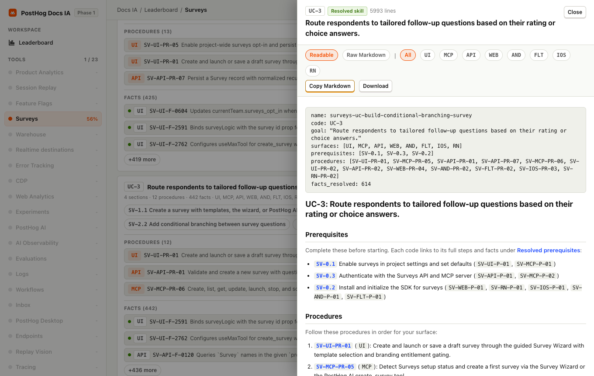

Full compiled skill shown above: [`uc-build-conditional-branching-survey.md`](skills/uc-build-conditional-branching-survey.md) (`5,992` lines, `614` resolved facts). All six raw compiled skill files tested below are attached under [`skills/`](skills/).

Five blinded agents ran against a local PostHog devbox. Each agent got only its compiled skill file, with no PostHog source code and no `posthog.com` docs. All five workflows passed end-to-end, and the runs surfaced real gaps in our fact extractor.

## Summary of live runs

| Use case | Attached full skill | What we tested | Result | Proof |
|---|---|---|---|---|
| `UC-1` | [`uc-launch-first-in-app-survey.md`](skills/uc-launch-first-in-app-survey.md) | Enable Surveys, launch a popover via wizard, capture a live response | Pass | Popover rendered on `/uc1-demo` and sent `survey shown` and `survey sent` (`HTTP 200`) |
| `UC-3` | [`uc-build-conditional-branching-survey.md`](skills/uc-build-conditional-branching-survey.md) | Test API validation guardrail, create a branching survey, test live branch | Pass | `HTTP 400` guardrail confirmed, rating `1` skipped Q3 and jumped to Q2, `100%` response rate |
| `UC-4` | [`uc-implement-custom-survey-ui.md`](skills/uc-implement-custom-survey-ui.md) | Build a custom Survey UI with `getActiveMatchingSurveys` and manual events | Pass | Custom card rendered live, `/stats/` showed `Shown 2`, `Responses 1 (50%)`, `Dismissed 1 (50%)` |
| `UC-5` + `UC-12` | [`uc-send-responses-to-slack-and-webhooks.md`](skills/uc-send-responses-to-slack-and-webhooks.md), [`uc-test-survey-notification-with-last-response.md`](skills/uc-test-survey-notification-with-last-response.md) | Create a Webhook notification and click `Send test` with last response | Pass | Matched `UC-1`'s real response and succeeded (`HTTP 200` in `120ms`) |
| `UC-8` | [`uc-run-recurring-nps-with-response-cap.md`](skills/uc-run-recurring-nps-with-response-cap.md) | Launch a recurring 0-10 NPS survey (`3` runs x `30` days, cap `5`) and submit `9` | Pass | Verified 3 start dates 30 days apart, live 0-10 popover, and NPS score `100` |

**PoC note:** These five devbox passes and the screenshots below only show early output. Complete skills still depend on full SDK indexing, crawling and splitting fixes, and tuned extraction.

## 1. `UC-1`: Launch a first popover survey

The agent turned on Surveys in Settings, launched a popover targeting `/uc1-demo` through the wizard, loaded the Web SDK in headless Chrome, and submitted a live response.

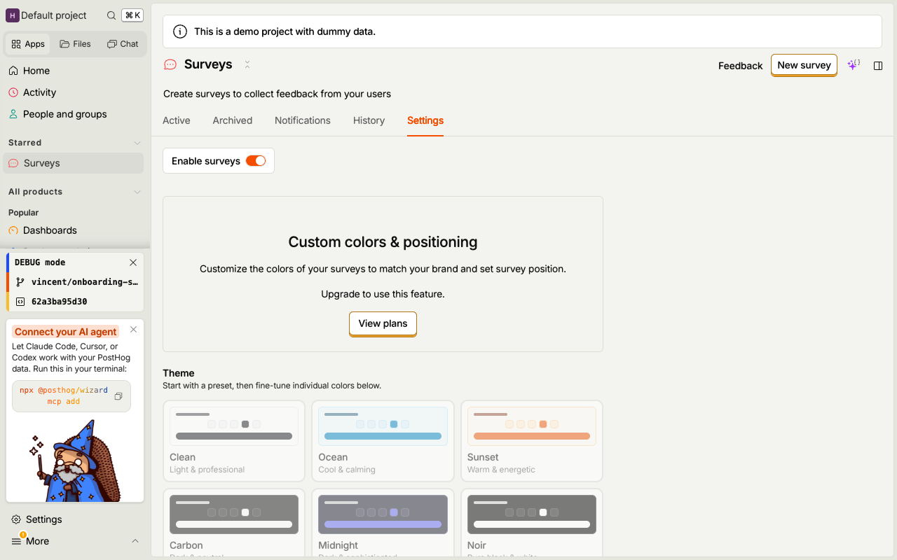

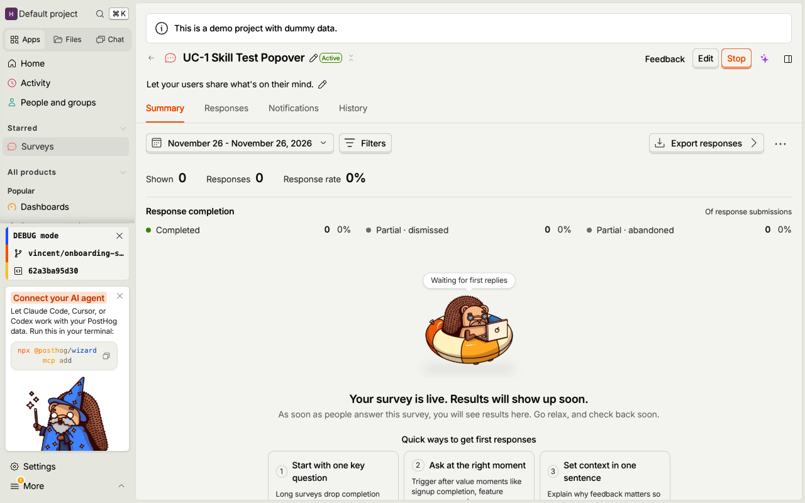

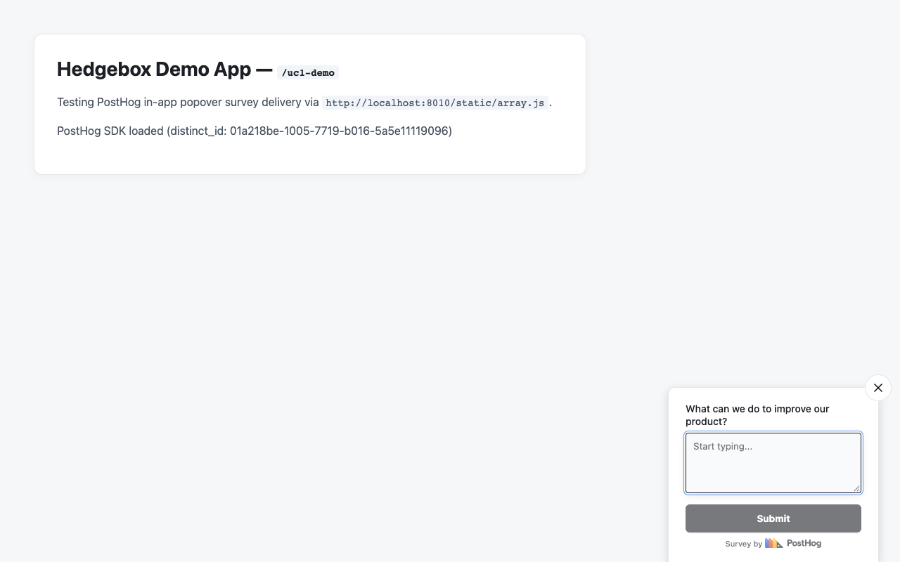

## 2. `UC-3`: Build a conditional branching survey

The agent first confirmed the API rejects shuffling plus branching (`HTTP 400`). It then created a 3-question rating survey over the REST API, checked the rules in the editor, and confirmed a rating of `1` jumped straight to `"What went wrong?"` and skipped Q3.

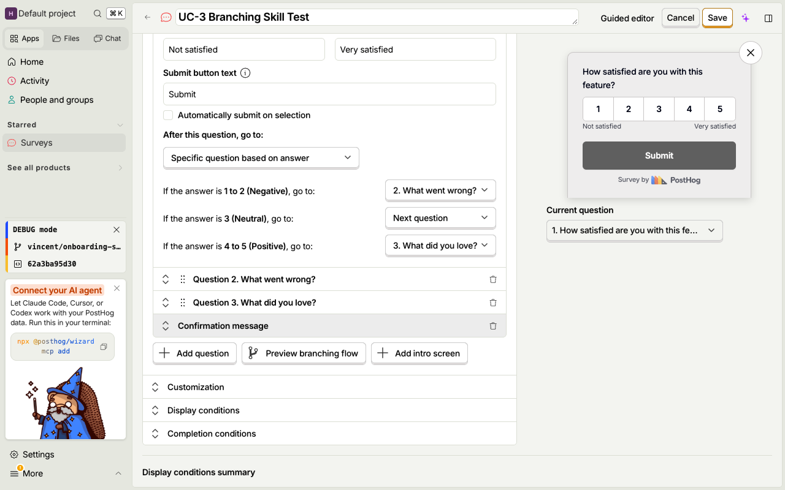

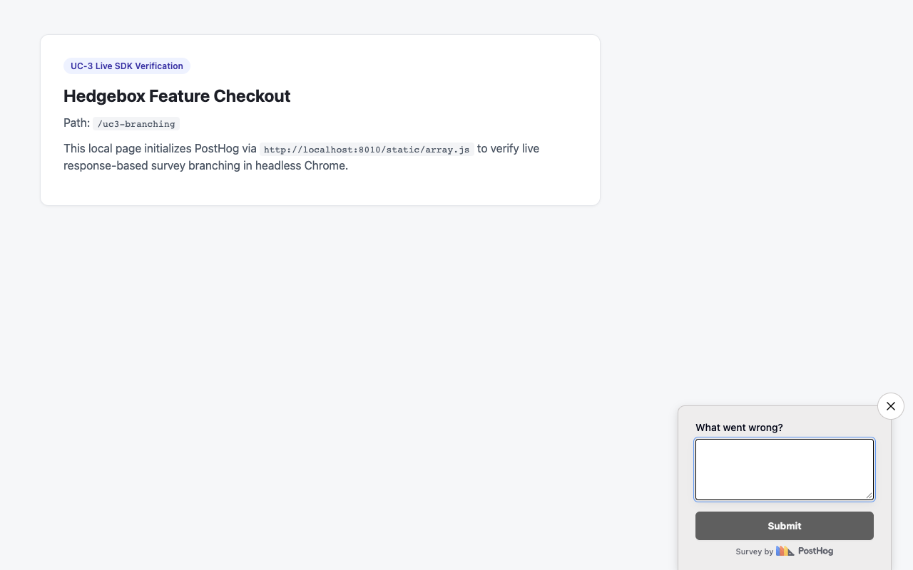

## 3. `UC-4`: Implement a custom survey UI

The agent created an API-type survey, built a custom page calling `getActiveMatchingSurveys`, submitted an answer in session 1, and dismissed the survey in session 2. PostHog's Summary UI recorded `Shown 2`, `Responses 1 (50%)`, and `Dismissed 1 (50%)`.

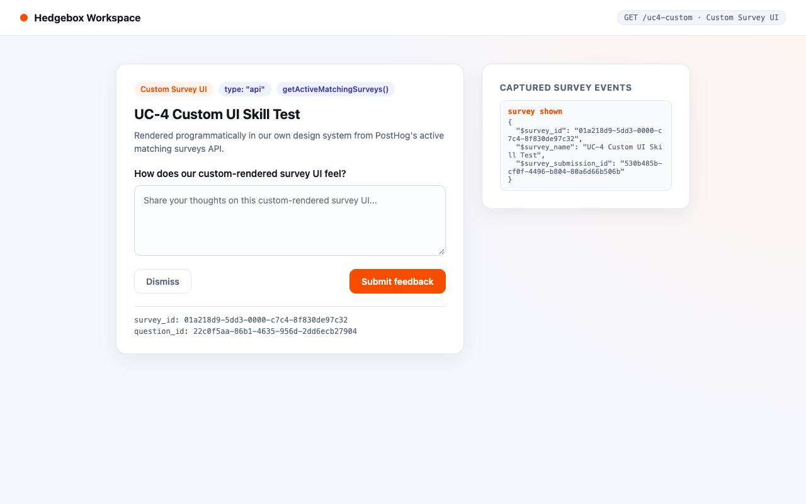

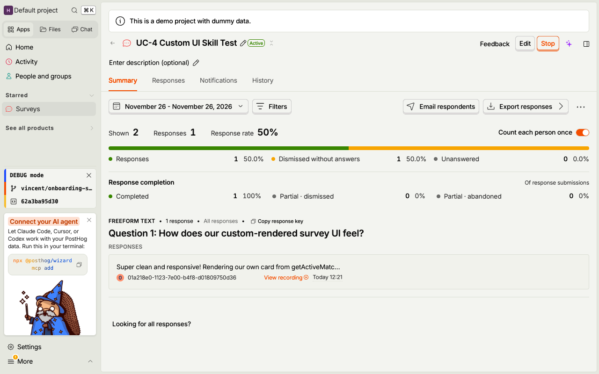

## 4. `UC-5` + `UC-12`: Send responses to a webhook and test it

The agent created a Webhook notification for the `UC-1` survey pointing at `httpbin.org/post`, then ran `Send test` -> `With last response`. It matched the real response and returned `HTTP 200` in `120ms`.

Bonus finding: the live run caught a real PostHog UI bug. Even after saving a Webhook destination, the toast still said `-> Slack` because the dialog reset destination state too early.

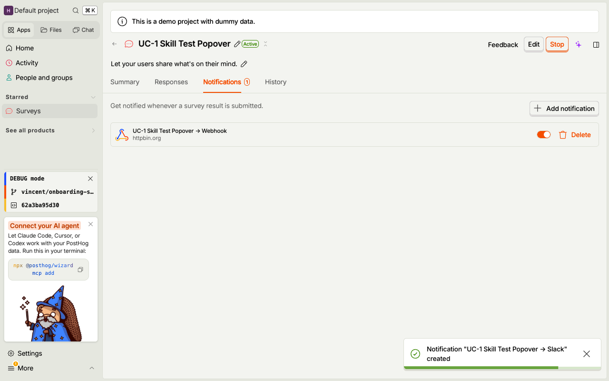

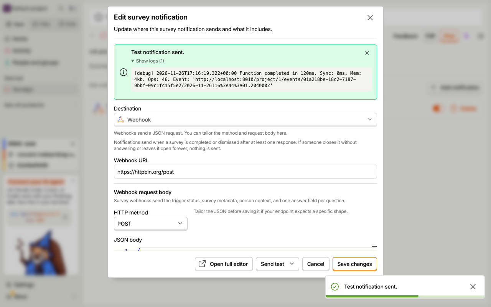

## 5. `UC-8`: Run a recurring NPS survey with a response cap

The agent launched a 0-10 NPS survey set to repeat 3 times every 30 days with a 5-response cap. It then submitted a `9` in headless Chrome and verified all 3 scheduled dates plus the NPS score (`100`) in PostHog.

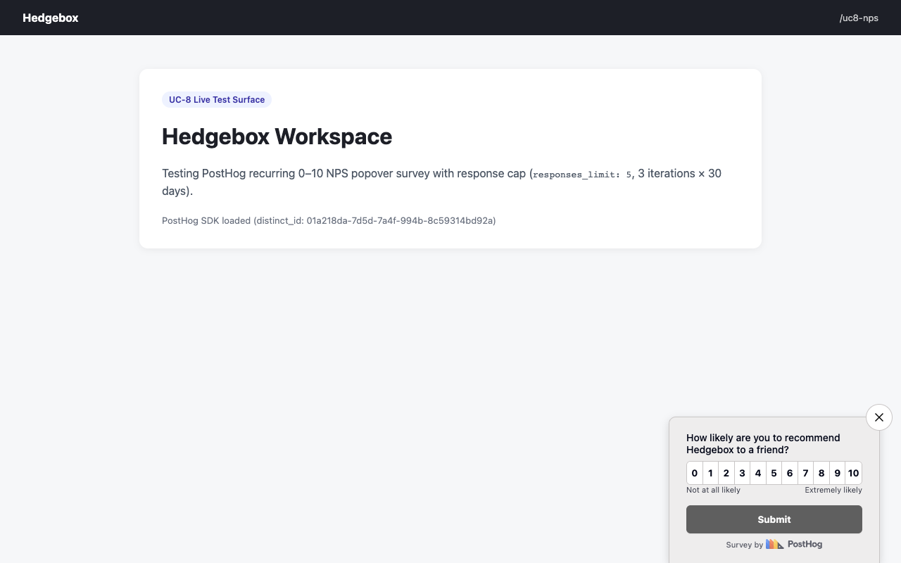

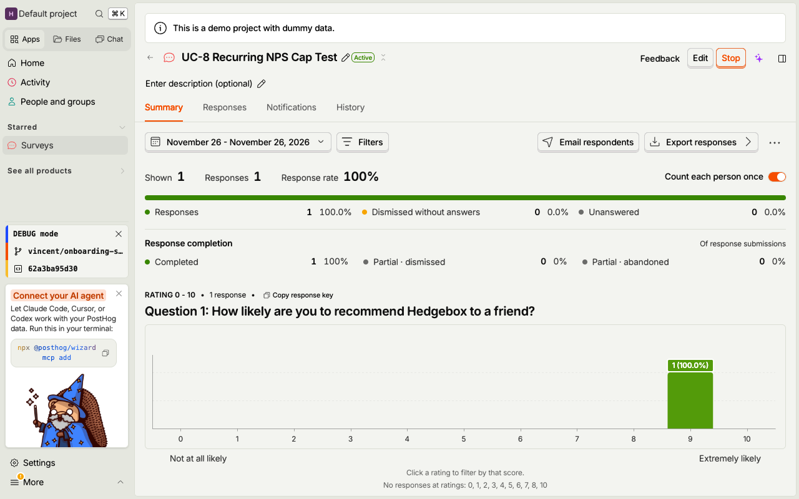

## Gaps these live runs exposed

These blinded runs caught four extractor gaps that static code review missed:

- **Missing happy-path schemas.** Type-only files (`types.ts`) were excluded, so skills listed validation errors while omitting required event keys like `$survey_id` and `$survey_response_<question_id>`.
- **Internal plumbing hid public SDK entry points.** Skills showed internal setup helpers instead of `posthog.init(...)` or waiting for `onActiveMatchingSurveysChanged` before calling `getActiveMatchingSurveys`.
- **Missing browser routes and auth headers.** UI steps cited React component names instead of literal URLs, and REST steps left out the `Authorization: Bearer` header.
- **Unsliced skills are way too big.** Packing all 8 surfaces into one file produced 6,000 to 8,400 lines of noise, so skills need surface slicing by default.

The headless Chrome runs also hit PostHog's bot filter and needed `opt_out_useragent_filter: true`.

## Details and stuff

<details>
<summary>How to reproduce (skill build, blinded agent instructions, devbox setup, and live object IDs)</summary>

### Reproduction steps

1. Build the Surveys IA and compiled one-pager skills from `docs-ia-crawl-experiments/typed-ports-pilot/`:
   ```bash
   node build-dewey-ia.mjs --export-dir out/full-surveys-cold/export --docsmap-dir out/docsmap-cold --out out/surveys-dewey-cold
   ```
   Skills write to `out/surveys-dewey-cold/skills/uc-*.md`.
2. Start a local PostHog devbox forwarded to `http://localhost:8010` with an active project (`project_id=1`) and personal API key.
3. Launch one fresh agent per use case with **only** that compiled skill `.md` file in context (zero access to `posthog`, `posthog-js`, or `posthog.com` docs) and browser/shell tools (headless Chrome / Playwright). Note: set `opt_out_useragent_filter: true` in `posthog.init(...)` so headless Chrome capture requests aren't dropped as bots.
4. Ask the agent to build and verify the use case end-to-end against `http://localhost:8010`, capture screenshots of PostHog UI + live SDK rendering, verify `/stats/` or `/invocations/`, and log every missing schema, route, or ambiguity in the raw skill.

### Run log and created objects

- **`UC-1` ([`uc-launch-first-in-app-survey.md`](skills/uc-launch-first-in-app-survey.md), 6,056 lines, 611 facts):** Ran `SV-UI-PR-05`, `SV-UI-PR-01`, `SV-UI-PR-03`, `SV-WEB-PR-01`, `SV-WEB-PR-03`. Created survey `01a218bb-bdc2-0000-5433-0c3564d577a4` (`POST /api/projects/1/surveys/` -> `201`), verified `surveys_opt_in`, rendered Shadow DOM popover via `array.js` on `/uc1-demo`, captured `survey shown` and `survey sent` (`HTTP 200` on `/i/v0/e/`).
- **`UC-3` ([`uc-build-conditional-branching-survey.md`](skills/uc-build-conditional-branching-survey.md), 5,992 lines, 614 facts):** Ran `SV-API-PR-01`, `SV-UI-PR-02`, `SV-WEB-PR-04`. Verified `SV-API-F-0242` (`appearance.shuffleQuestions: true` + branching -> HTTP `400`). Created survey `01a218b4-cbd3-0000-8883-a9364daebe77`. Verified branching on `/uc3-branching` and `/stats/` (`response_rate: 100.0`).
- **`UC-4` ([`uc-implement-custom-survey-ui.md`](skills/uc-implement-custom-survey-ui.md), 7,965 lines, 797 facts):** Created API survey `01a218d9-5dd3-0000-c7c4-8f830de97c32` (question UUID `22c0f5aa-86b1-4635-956d-2dd6ecb27904`). Built `/uc4-custom` waiting for `onActiveMatchingSurveysChanged` (`isLoaded: true`), sent `$survey_response_22c0f5aa-86b1-4635-956d-2dd6ecb27904`, `$survey_completed: true`, and `survey dismissed` in session 2.
- **`UC-5` + `UC-12` ([`uc-send-responses-to-slack-and-webhooks.md`](skills/uc-send-responses-to-slack-and-webhooks.md), 6,995 lines, and [`uc-test-survey-notification-with-last-response.md`](skills/uc-test-survey-notification-with-last-response.md), 6,471 lines):** Created HogFunction `01a218db-1afc-0000-8f48-b26a23e64bd4` (`POST /api/projects/1/hog_functions/` -> `201`). Ran `POST /invocations/` matching event `01a218be-18c2-7187-9bbf-09c1fc15f5e2` (`HTTP 200`, `120ms`).
- **`UC-8` ([`uc-run-recurring-nps-with-response-cap.md`](skills/uc-run-recurring-nps-with-response-cap.md), 8,403 lines, 849 facts):** Created survey `01a218d9-99b2-0000-e684-dd39e33c1d76` (`schedule: "recurring"`, `iteration_count: 3`, `iteration_frequency_days: 30`, `responses_limit: 5`). Confirmed `iteration_start_dates` (`2026-11-26`, `2026-12-26`, `2027-01-25`) and targeting flag `$survey_responded/<id>/1`.

</details>
