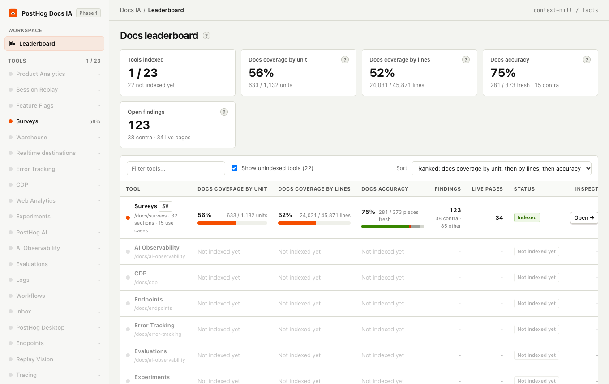
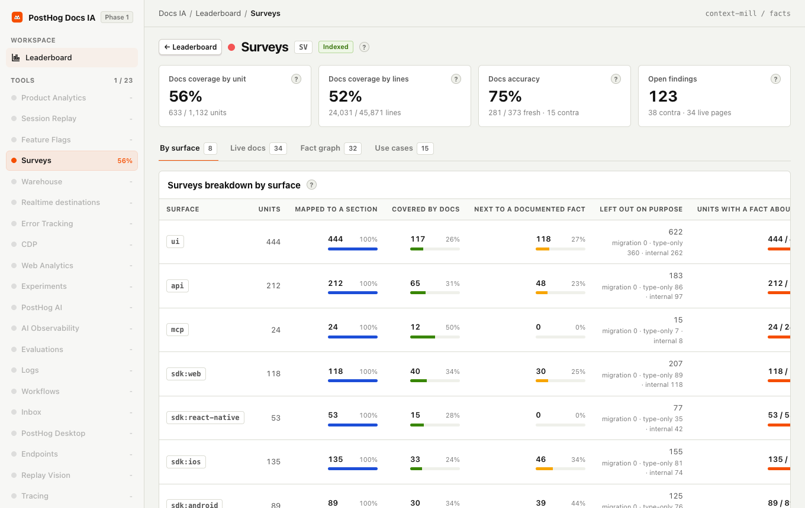
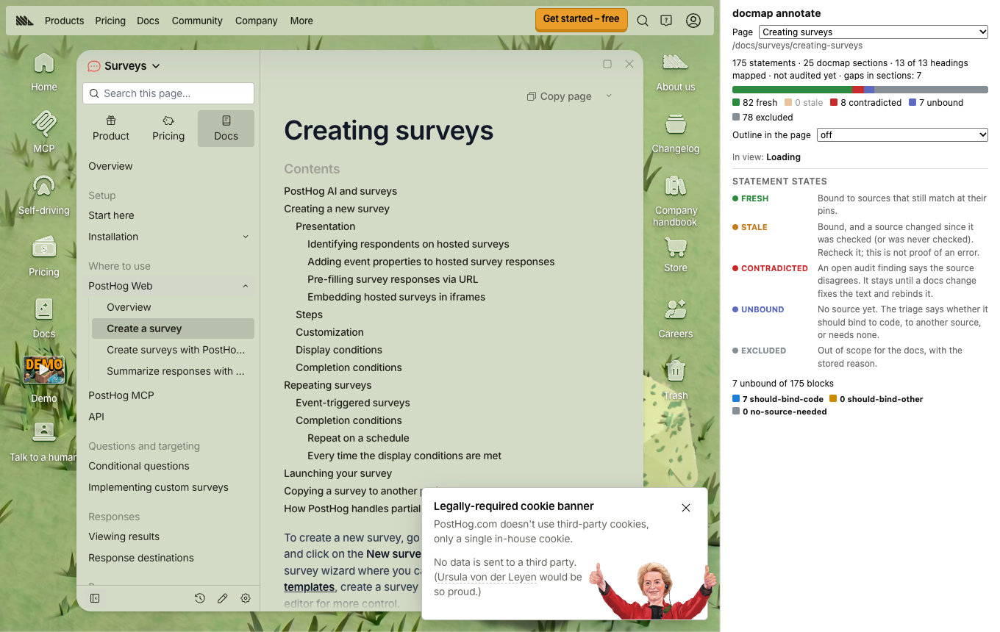

# Addendum 2: Live docs mapping and contradiction proof

> [!NOTE]
> **PoC results aren't final.** These coverage numbers, mappings, and screenshots test whether the concept is valuable, rather than whether it's production-ready. Solid numbers and mappings still need:
> - **All SDKs and services indexed.** PostHog products intersect across repo and product boundaries, so partial indexes miss real behavior.
> - **Crawling, splitting, and mapping fixed.** All three stages still have remaining bugs.
> - **Retrieval, extraction, and verification optimized.** Each still needs substantial work.

We mapped all 34 live Surveys pages on `posthog.com` against pinned Surveys code across 5 repos (`posthog`, `posthog-js`, `posthog-ios`, `posthog-android`, and `posthog-flutter`).

## Coverage scorecard

The mapper split the 34 pages into 1,206 pieces: 729 non-structural pieces and 477 structural items (headings, intros, and framing). It also caught 20 broken links to `/docs/surveys/sdk-feature-support`.

| Metric | Value | What it means |
|---|---|---|
| Pages audited | 34 | All live Surveys docs, including imported onboarding snippets |
| Total pieces | 1,206 | 729 non-structural pieces + 477 structural pieces |
| `fresh` | 433 (61% accuracy) | Verified against code (`433/712` checkable pieces, 50 with minor caveats) |
| `contradicted` | 17 | Confirmed by the second-pass judge, 0 false positives |
| `stale` | 17 | Outdated wording or drift flagged without direct contradiction |
| `prose-backed` | 7 | Backed only by spec prose, kept separate from `fresh` |
| `unverified` | 171 | Screenshots, videos, or third-party claims |
| `unbound` | 84 | Checkable statements with no code pin yet |
| Unit coverage | 59% | 687 of 1,166 public code units (via procedures, 376 via 1-hop) |
| Line coverage (1-hop) | 56% | 25,520 of 45,773 public lines (`72.5%` via procedures) |
| Excluded code | 17,200 lines | Internal plumbing, types, and migrations |



**PoC note:** These scorecard numbers and the leaderboard screenshot aren't final. Missing SDK and service indexes, mapping bugs, and untuned extraction and verification still shift these numbers.

### Coverage by surface

| Surface | Public units | Covered (1-hop) | Covered (via procedures) | Public lines | Line coverage (1-hop) |
|---|---:|---:|---:|---:|---:|
| `ui` | 399 | 104 | 179 | 26,499 | 54.8% |
| `api` | 256 | 76 | 160 | 6,404 | 56.5% |
| `mcp` | 23 | 8 | 12 | 569 | 56.4% |
| `sdk:web` | 143 | 61 | 91 | 3,966 | 65.8% |
| `sdk:react-native` | 50 | 21 | 30 | 1,616 | 74.9% |
| `sdk:ios` | 131 | 46 | 87 | 2,529 | 43.3% |
| `sdk:android` | 103 | 46 | 79 | 2,330 | 62.0% |
| `sdk:flutter` | 61 | 14 | 49 | 1,860 | 37.0% |



Each page also renders in a side-panel viewer showing claim states and clickable source pins right next to live `posthog.com` docs.



**PoC note:** These per-surface numbers and side-panel states are rough snapshots, rather than final coverage. Partial indexes, splitting and mapping bugs, and unoptimized retrieval still skew them.

## 17 confirmed contradictions

A second-pass judge read the full source symbol for every row below before flagging it. The 7-PR Surveys docs stack (`#22896` to `#22902`) fixes all 17.

**PoC note:** Each row below matches pinned code, though the total count isn't final. Full cross-repo indexing, crawling and mapping fixes, and verification tuning will still change that count.

| Doc piece | What the doc claimed | Source code proving it wrong | Pin (`commit-md5`) |
|---|---|---|---|
| `conditional-questions#p17` | Preview can't test branching interactively | [`surveyPreviewNavigation.ts#L8-L22`](https://github.com/PostHog/posthog/blob/97bf79d0cc3bed5e7815b677d9ed5cdcd7cf075d/frontend/src/scenes/surveys/surveyPreviewNavigation.ts#L8-L22) | `97bf79d0-ce5d4804` |
| `creating-surveys#p22` | Only three options exist for displaying a survey | [`models.py#L42-L395`](https://github.com/PostHog/posthog/blob/97bf79d0cc3bed5e7815b677d9ed5cdcd7cf075d/products/surveys/backend/models.py#L42-L395) | `97bf79d0-f41cd6fc` |
| `creating-surveys#p64` | Always starts at the first non-prefilled question | [`survey-url-prefill.ts#L162-L212`](https://github.com/PostHog/posthog-js/blob/6ef60e8d3caf5ac58d0e7d83cf1e394155b414fc/packages/browser-common/src/surveys/survey-url-prefill.ts#L162-L212) | `6ef60e8d-f32c92b8` |
| `creating-surveys#p94` | Hosted URL uses `us.posthog.com/external_surveys/` (`?embed=true`) | [`CopySurveyLink.tsx#L8-L11`](https://github.com/PostHog/posthog/blob/97bf79d0cc3bed5e7815b677d9ed5cdcd7cf075d/frontend/src/scenes/surveys/CopySurveyLink.tsx#L8-L11) | `97bf79d0-785a212d` |
| `creating-surveys#p135` | Select `Every time the event is sent` | [`SurveyEventTrigger.tsx#L102-L251`](https://github.com/PostHog/posthog/blob/97bf79d0cc3bed5e7815b677d9ed5cdcd7cf075d/frontend/src/scenes/surveys/SurveyEventTrigger.tsx#L102-L251) | `97bf79d0-901767bd` |
| `creating-surveys#p136` | Select `Just once` for event-triggered surveys | [`SurveyEventTrigger.tsx#L102-L251`](https://github.com/PostHog/posthog/blob/97bf79d0cc3bed5e7815b677d9ed5cdcd7cf075d/frontend/src/scenes/surveys/SurveyEventTrigger.tsx#L102-L251) | `97bf79d0-901767bd` |
| `creating-surveys#p160` | Recurring surveys can't be open-ended | [`models.py#L42-L395`](https://github.com/PostHog/posthog/blob/97bf79d0cc3bed5e7815b677d9ed5cdcd7cf075d/products/surveys/backend/models.py#L42-L395) | `97bf79d0-f41cd6fc` |
| `creating-surveys#p186` | Partial responses only work in `posthog-js` | [`PostHogSurveysIntegration.kt#L42-L1296`](https://github.com/PostHog/posthog-android/blob/4c3c125da08c48fd09289ccd5a092ead9d59138d/posthog-android/src/main/java/com/posthog/android/surveys/PostHogSurveysIntegration.kt#L42-L1296) | `4c3c125d-d4173e57` |
| `creating-surveys#p194` | `survey dismissed` only fires with zero answers | [`PostHogSurveysIntegration.kt#L424-L470`](https://github.com/PostHog/posthog-android/blob/4c3c125da08c48fd09289ccd5a092ead9d59138d/posthog-android/src/main/java/com/posthog/android/surveys/PostHogSurveysIntegration.kt#L424-L470) | `4c3c125d-9a901328` |
| `implementing-custom-surveys#p1` | Custom surveys only work in the Web SDK | [`PostHogSurveysIntegration.kt#L349-L401`](https://github.com/PostHog/posthog-android/blob/4c3c125da08c48fd09289ccd5a092ead9d59138d/posthog-android/src/main/java/com/posthog/android/surveys/PostHogSurveysIntegration.kt#L349-L401) | `4c3c125d-abf24bc2` |
| `implementing-custom-surveys#p83` | Example payload uses `"type": "open_text"` | [`survey.py#L603-L633`](https://github.com/PostHog/posthog/blob/97bf79d0cc3bed5e7815b677d9ed5cdcd7cf075d/products/surveys/backend/api/survey.py#L603-L633) | `97bf79d0-71ddc3e8` |
| `installation/android#p24` | HTML descriptions on thank-you screen render as plain text | [`ConfirmationScreen.kt#L33-L65`](https://github.com/PostHog/posthog-android/blob/4c3c125da08c48fd09289ccd5a092ead9d59138d/posthog-android-surveys-compose/src/main/java/com/posthog/android/surveys/compose/internal/ui/ConfirmationScreen.kt#L33-L65) | `4c3c125d-47defed6` |
| `setup#p5` | Enable `"surveys app"` in your project's apps | [`SurveySettings.tsx#L23-L68`](https://github.com/PostHog/posthog/blob/97bf79d0cc3bed5e7815b677d9ed5cdcd7cf075d/frontend/src/scenes/surveys/SurveySettings.tsx#L23-L68) | `97bf79d0-db3be7b7` |
| `setup#p6` | Must enable `opt_in_site_apps` for surveys | [`browser-surveys.ts#L14-L29`](https://github.com/PostHog/posthog-js/blob/6ef60e8d3caf5ac58d0e7d83cf1e394155b414fc/packages/browser/src/browser-surveys.ts#L14-L29) | `6ef60e8d-6745325b` |
| `setup#p7` | Init snippet requires `opt_in_site_apps: true` | [`browser-surveys.ts#L14-L29`](https://github.com/PostHog/posthog-js/blob/6ef60e8d3caf5ac58d0e7d83cf1e394155b414fc/packages/browser/src/browser-surveys.ts#L14-L29) | `6ef60e8d-6745325b` |
| `troubleshooting#p31` | SDKs stopped capturing `$survey_response` after February 25 | [`events.ts#L29-L55`](https://github.com/PostHog/posthog-js/blob/6ef60e8d3caf5ac58d0e7d83cf1e394155b414fc/packages/core/src/surveys/events.ts#L29-L55) | `6ef60e8d-efb1be64` |
| `viewing-results#p6` | Survey page has a `"Results"` tab | [`SurveyViewRedesign.tsx#L90-L471`](https://github.com/PostHog/posthog/blob/97bf79d0cc3bed5e7815b677d9ed5cdcd7cf075d/frontend/src/scenes/surveys/SurveyViewRedesign/SurveyViewRedesign.tsx#L90-L471) | `97bf79d0-b14febd2` |

## Details and stuff

<details>
<summary>How to reproduce (commands, pipeline stages, pinned commits, and coverage math)</summary>

### Reproduction command

From `docs-ia-crawl-experiments/typed-ports-pilot/`:

```bash
# Cold outside-in run (59% unit coverage, 56% line coverage, 17 contradictions)
node run-docsmap.mjs --out out/docsmap-cold --concurrency 6 --fresh

# Preview the side-panel annotator locally on port 8003
node serve-annotate-8003.mjs
```

### Mapper stages (`run-docsmap.mjs`)

- **D0 (Source segmentation):** Splits all 34 MDX pages under `contents/docs/surveys/` plus imported snippets and onboarding TSX (`createSurveysStepsFromPA`) into atomic pieces, detects broken internal links, and runs `git blame` on structural items.
- **D1 (Candidate retrieval, 0 LLM):** Stratified cross-surface hybrid retriever picks candidate facts and procedures per checkable piece.
- **D2a (First-pass claim binding):** Gemini 4 Neon (`medium` effort) maps each piece against candidate facts.
- **D2b (Second-pass contradiction judge):** Gemini 4 Neon (`high` effort) reads the full pinned AST symbol slice and runs global fact re-search before confirming any `contradicted` or `unbound` finding.
- **D2c (Cross-SDK equivalent binder):** Gemini 4 Neon (`medium` effort) binds shared SDK-agnostic claims to equivalent facts across Web, RN, iOS, Android, and Flutter.
- **D3 + D4 (States and coverage):** Tallies the 7 canonical claim states (`fresh`, `prose-backed`, `stale`, `contradicted`, `structural`, `unverified`, `unbound`) and computes 8-surface coverage across `1,166` public `worthIndexing` units (`45,773` lines), excluding `17,200` rule-labeled internal/widget/type/migration lines (`SV-*-D-EXCL-*`). 1-hop line coverage (`56%`) credits backend validators/serializers reached via 1-hop typed ports (procedure-level reach covers `72.5%`).

### Pinned commits

- `PostHog/posthog.com`: `433efe56a892ac53ab13573e79e22c7e72e5bafa` (`34` live Surveys pages, `174` open findings)
- `PostHog/posthog`: `97bf79d0cc3bed5e7815b677d9ed5cdcd7cf075d`
- `PostHog/posthog-js`: `6ef60e8d3caf5ac58d0e7d83cf1e394155b414fc`
- `PostHog/posthog-ios`: `ba9fa9e4c09230afa1c620d5d76d7b304e8223c4`
- `PostHog/posthog-android`: `4c3c125da08c48fd09289ccd5a092ead9d59138d`
- `PostHog/posthog-flutter`: `df97547d612967e99784ccd8e2c6fb0dd6155a5b`

</details>
