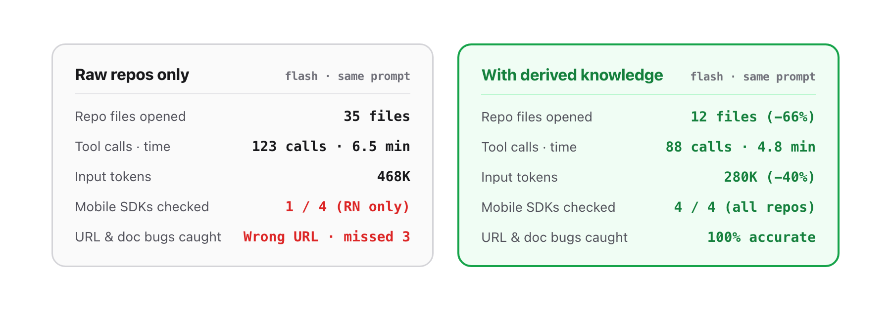

# Addendum 4: Controlled `flash` A/B test and pointing-and-calling

This addendum backs two parts of the [main RFC](2026-11-16-docs-ia-middle-layer.md):

1. A controlled test of `flash` (a fast, low-cost model) auditing Surveys docs **without** vs **with** derived knowledge.
2. Why structured checklists (*shisa kanko*) let cheaper models do reliable docs audits.

## 1. Controlled `flash` A/B test

### Setup

Two identical read-only `flash` agents got the same 3-part audit prompt on pre-PR Surveys docs:

1. Check `creating-surveys.mdx` against code for hosted survey URLs (`posthogsurveys.com` vs `posthog.com`), question types (`open` vs `open_text`), and mobile partial responses.
2. Find every docs page affected if partial `survey sent` events change.
3. Trace how a Workflow triggers a survey (`Show survey`) and what needs updating in `destinations.mdx`.

Each arm got different inputs:

- **Condition A (raw repos only):** Could read `posthog`, `posthog-js`, and `contents/docs/surveys/`.
- **Condition B (with derived knowledge):** Got the Surveys IA and docs map JSON files alongside `contents/docs/surveys/`, plus optional source reads.

### Scorecard

| Metric | Condition A (Raw repos) | Condition B (With derived IA) | Change |
|---|---:|---:|---|
| Turns | 39 | 33 | -15% |
| Wall-clock time | 6.5 min | 4.8 min | -25% |
| Tool calls | 123 | 88 | -28% |
| Repo files opened | 35 | 12 | -66% |
| Non-cached input tokens | 468K | 280K | -40% |
| Hosted survey URL check | **Wrong** (said `us.posthog.com` was right) | **Correct** (caught `posthogsurveys.com`) | Caught bug |
| Mobile partial responses | **1 / 4 SDKs** (React Native only) | **4 / 4 SDKs** | Caught all 4 |
| Affected docs and snippets | 15 files | 18 files | +3 files |
| `destinations.mdx` audit | Missed 2 existing bugs | Caught both existing bugs | +2 bugs |

### Why raw-repo `flash` failed

1. **Stale local checkout.** Condition A grepped a local `posthog` checkout behind `origin/master`, found no `posthogsurveys.com`, and marked the outdated doc accurate. Condition B checked the pinned fact and flagged the contradiction immediately.
2. **Missed sibling repos.** Mobile SDKs live in separate repos, so Condition A only checked React Native. Condition B pulled all four mobile SDKs straight from the cross-repo IA.
3. **Missed symptom pages and existing bugs.** Condition A missed `setup.mdx`, three mobile snippet tables, and two already-broken statements in `destinations.mdx`.

### What's still missing for Condition B

Condition B still took 33 turns writing ad-hoc Python and grep commands over raw `1.1 MB` JSON files. A thin lookup CLI over the IA cuts most of that overhead.

## 2. Pointing and calling (*shisa kanko*)

Japanese train conductors point at each gauge and call its state aloud before moving. FAA manuals enforce numbered checklists. Both assume capable people still make slips when freehanding.

Agents fail the same way. Give even a strong model an open-ended prompt ("check if Surveys docs match code"), and it skims, misses sibling repos, or rationalizes stale files. Wrap a cheap model in narrow tools, exact schemas, and code-pinned quotes, and its checks become repeatable:

1. **Pin symbols first.** Index code symbols and watched YAML manifests with detached `commit` and `md5` hashes, splitting huge files into overlapping windows.
2. **Require verbatim quotes.** Reject any extracted fact whose quote isn't literally inside the pinned symbol or points to a docs file.
3. **Link boundaries cleanly.** Wire internal events, HTTP routes, and model hooks deterministically (0 LLM calls), then use a small agent pass to map cross-team calls onto pinned `platform-*` seams.
4. **Refresh by hash.** Unchanged MD5s bump their commit SHA with 0 LLM calls. Only changed functions wake a judge.
5. **Never delete codes.** Renames leave forward pointers and deletions leave tombstones, preserving the code-diff trail behind every doc edit.

## Details and stuff

How to reproduce (exact 3-part prompt, workspace mounts, transcript metrics, and schema spec)

### Reproduction setup

1. Spawn two read-only `flash` subagents (`Model: "flash"`, no edit tools, no network) with the identical 3-part audit prompt against pre-PR `posthog.com` `contents/docs/surveys/`:
   - **Q1:** Check `creating-surveys.mdx` against production code for hosted-survey URL domains (`posthogsurveys.com` vs `posthog.com`), question types (`open` vs `open_text`), and mobile partial-response support across RN, iOS, Android, and Flutter.
   - **Q2:** List every file and section under `contents/docs/surveys/` (including `_snippets/`) affected if a PR changes `enable_partial_responses` or `$survey_completed: false` on intermediate `survey sent` events.
   - **Q3:** Trace how a Workflow triggers a survey (`Show survey`), whether it appears under Data pipeline destinations, what hidden property/condition links it to the SDK, and what needs updating in `destinations.mdx`.
2. **Condition A (raw repos only):** Give paths to local `posthog`, `posthog-js`, and `contents/docs/surveys/`. Do not give IA files.
3. **Condition B (with derived IA):** Give paths to `surveys-dewey-ia.json`, `surveys.docsmap.json`, and `docsmap-report.json` alongside `contents/docs/surveys/`, plus optional source code reads.
4. Parse both `transcript.jsonl` logs for turn count (`PLANNER_RESPONSE`), wall-clock time, shell/read tool counts, distinct files opened, and non-cached input tokens.

### Exact measured transcript traces

- **Condition A (run `542ce800`):** `39` turns, `389s`, `123` tool calls (`74` shell, `46` file reads), `35` distinct files (`28` code, `7` docs), `467,998` non-cached input tokens. Local `posthog` `HEAD` sat at `3d571843ac5` behind `origin/master` (`97bf79d0cc3`), causing it to report `us.posthog.com` as accurate. Checked only React Native (`packages/react-native/src/surveys/components/Surveys.tsx:165-167`), missing iOS, Android, Flutter, `setup.mdx:49-50`, three mobile `_snippets/*-surveys-installation.mdx` tables, and two `destinations.mdx` bugs (`L24` nonexistent toggle, `L50` renamed `Results` tab).
- **Condition B (run `198646bb`):** `33` turns, `290s`, `88` tool calls (`57` shell, `25` file reads), `12` distinct files (`4` IA JSONs, `4` docs, `4` code), `279,711` non-cached input tokens. Cited `SV-UI-F-0008`/`0010` (`CopySurveyLink.tsx:8-17, 31`), all 4 mobile SDKs (`SV-RN-F-0187`, `SV-IOS-F-0126`, `SV-AND-F-0079`, Flutter bridge), all `18` affected files, and both existing `destinations.mdx` bugs (`SV-ALL-C-0082`, `SV-UI-C-0356`).

### Pipeline schema spec (`context-mill` `scripts/docs-ia/models/fact.mjs`)

- **Detached AST pin:** `{ repo, file, symbol, commit, own_runs, code_hash }` (MD5 of normalized symbol lines, symbols over 500 lines split into overlapping 380-line windows).
- **13 closed fact types:** `fact`, `schema`, `guard`, `input`, `limit`, `default`, `error`, `branch`, `control`, `storage`, `schedule`, `wiring`, `port`.
- **10 typed ports:** `http`, `event`, `store`, `model_hook`, `task`, `query`, `sdk_hook`, `ui_nav`, `mcp`, `external`.
- **Source quarantine:** Rejects any fact pinned under `contents/docs/`, `contents/tutorials/`, or `docs/onboarding/`.

