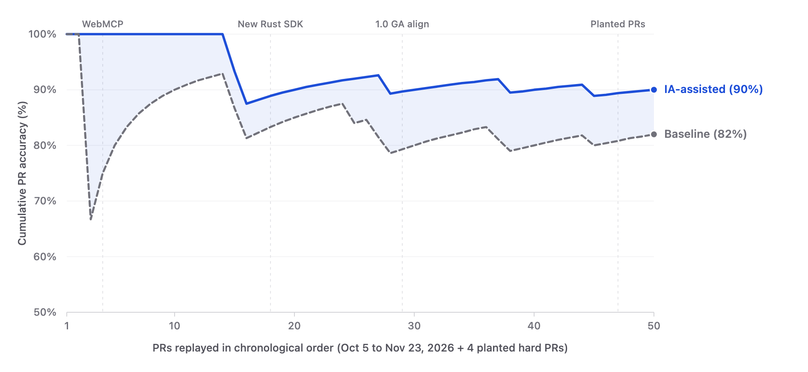
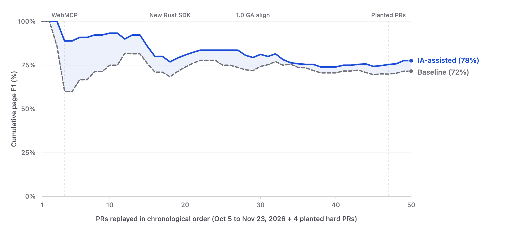
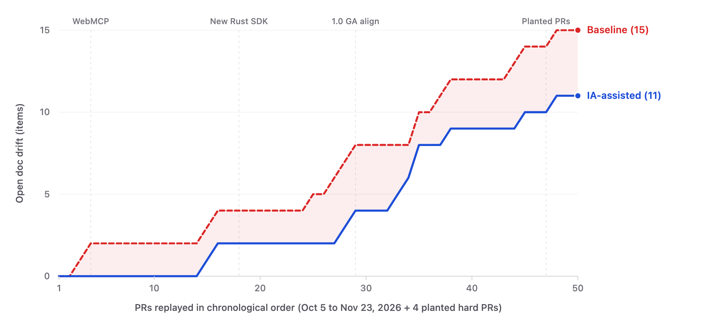

# Addendum 5: Two-arm PR maintenance replay (`mcp-analytics`)

An active Docs IA kept a PR-triggered docs agent more accurate over two months of real code changes. It cut false-positive edits in half and left less drift on disk.

## What we tested

We replayed 8 weeks of merged history on MCP Analytics in order, from October 3 to November 23, 2026, across 20 live docs pages:

1. **46 real merged code PRs** across `posthog`, `posthog-js`, `posthog-python`, and `posthog-rs`. They include routine noise, bug fixes, unreleased feature flags, breaking changes, and 1.0 releases. They also add two brand-new surfaces that didn't exist on October 3: WebMCP in `posthog-js` and the new Rust SDK in `posthog-rs`.
2. **3 real human docs PRs** on `posthog.com`, including a page deletion (`#21548`) and a 19-page editorial trim (`#22541`).
3. **4 planted hard PRs** at the end to stress silent default flips, backend query-order changes, deleted options, and large behavior-preserving refactors.

Each code PR ran against each agent's own evolving copy of `contents/docs/mcp-analytics/`. A missed update or wrong edit stayed on disk until a later PR fixed it.

## The two agents we compared

This local test simulates a PR-triggered docs-maintenance agent, such as Knowledge Writer. Both arms ran Sonnet on medium effort (`claude-sonnet-5-5`) through the Claude Code SDK with the same file tools, PR diff, and changed source files.

We want an economical, repeatable assistance tool for cheaper agents rather than max-effort frontier runs, so we picked Sonnet on medium. We scored the real `.mdx` diffs each agent wrote on disk.

1. **Baseline agent.** Plain instructions to keep the docs accurate, with no IA.
2. **IA-assisted agent.** Read/write IA tools and a 4-step decision tree: check what changed in the IA, update or retire changed facts, map new or unmapped code (including brand-new SDKs), then trace impact to update docs and claim bindings together. Plain scripts run first to defer unreleased feature flags, skip excluded internal files, and reconcile human `.mdx` edits with zero LLM calls.

## Accuracy and drift

Across all 50 code PRs, the IA-assisted agent made fewer bad edit calls, picked the right pages more often, and left less drift on disk:

| Metric (50 chronological code PRs) | Baseline agent | IA-assisted agent | Change |
| --- | ---: | ---: | ---: |
| **PR decision accuracy** (edit vs skip) | `82.0%` (`41/50`) | **`90.0%`** (`45/50`) | **`+8.0 pts`** |
| **PR trigger F1** | `0.862` | **`0.918`** | **`+5.6 pts`** |
| **False-positive PRs** (unneeded edits) | `8` | **`4`** | **`-50%`** |
| **Missed PRs** (false negatives) | `1` | `1` | `0` |
| **Edited-page precision** | `75.0%` | **`81.3%`** | **`+6.3 pts`** |
| **Edited-page recall** | `68.6%` | **`74.3%`** | **`+5.7 pts`** |
| **Edited-page F1** | `0.716` | **`0.776`** | **`+6.0 pts`** |
| **Open doc drift at PR 50** (missed checks + spurious PRs) | `15` | **`11`** | **`-27%`** |
| **Live factual checks passing at PR 50** | `82.9%` (`34/41`) | `82.9%` (`34/41`) | `0` |
| **Average wall time per PR** | `11.4s` | `17.9s` | `+6.5s` |

The IA-assisted agent held `100%` PR decision accuracy for the first 14 PRs and stayed 4 to 11 points ahead through PR 50 (finishing `+8.0` points ahead).



Edited-page F1 stayed ahead of Baseline from PR 3 onward and finished at `78%` vs `72%`.



Open doc drift counts unresolved factual checks on disk plus false-positive PRs. Baseline climbed faster during heavy release weeks and finished `36%` higher (`15` vs `11`).



## Keeping the IA current

On October 3, the IA started with `2,080` code-pinned facts (`0` WebMCP, `0` Rust SDK) and `501` bound docs claims across `20` pages. Over 53 events, the agent maintained it on its own in `195` tool calls:

- **Updated `74` facts** when pinned code changed behavior, and **retired `43`** with tombstones when code was deleted (including `29` from the old home layout removal in `posthog#135656`).
- **Mapped `56` new facts** into the live IA, growing WebMCP from `0` to `4` (`posthog-js#5191`) and the new Rust SDK from `0` to `11` (`posthog-rs#308`, `#333`).
- **Updated or minted `76` claim bindings** alongside `.mdx` edits, ending with `2,093` live facts, `502` live claims, and `73` retired tombstones.
- **Zero-LLM gates:** Skipped `4` non-doc PRs (two unreleased feature flags, an offline eval runner, a frontend refactor) and reconciled all `3` human `.mdx` PRs (auto-retiring `7` claims when `#21548` deleted `surfaces/desktop.mdx`).

## Concrete examples

- **Unreleased feature flag (`posthog#128669`).** Baseline documented an unreleased setup mode in `surfaces/api.mdx`. The IA-assisted agent deferred it in `0.84s` with `0` LLM calls.
- **Brand-new surface (`posthog-js#5191`, WebMCP).** Baseline added a note to `events.mdx` and missed installation docs. The IA-assisted agent mapped `4` WebMCP facts and added the setup guide to `installation/index.mdx`.
- **Minor UI details (`posthog#125299`, `#131278`).** Baseline edited `surfaces/web-app.mdx` and `surfaces/api.mdx` on both. The IA-assisted agent updated the code-level facts, saw summary claims still held, and left `.mdx` untouched.
- **Cross-surface feedback (`posthog#126523`).** Baseline updated `missing-capability.mdx` and `events.mdx`, missing `surfaces/api.mdx`. The IA-assisted agent updated both `missing-capability.mdx` and `surfaces/api.mdx`.
- **Silent option removal (planted `reportMissing` deletion).** Baseline missed the SDK comparison table in `installation/index.mdx`. The IA-assisted agent retired `7` deleted facts and updated all `5` affected pages.

## Caveats and remaining gaps

- **Model tier and ceiling.** Both arms ran Sonnet on medium effort (`claude-sonnet-5-5`). Opus on medium with the IA would likely catch more of the multi-surface misses below. Fable on high, extra-high, or max effort with no guidance could still beat these scores. That's not the point: the IA is an economical, repeatable assistance tool for cheaper agents.
- **Latency.** IA maintenance added `6.5s` per PR (`17.9s` vs `11.4s`).
- **Multi-surface features.** On custom harnesses (`posthog#124838`), Baseline updated only `events.mdx`, and the IA-assisted agent updated `events.mdx` and `surfaces/web-app.mdx`. Both still missed `surfaces/api.mdx` and `queries.mdx`.
- **Unstated limits.** When `posthog#122171` raised the session ID limit from `64` to `128`, the IA-assisted agent updated the IA fact. October 3 docs never mentioned a limit, so neither arm edited `events.mdx`.
- **Wrong-page routing.** On `posthog-rs#333`, the IA-assisted agent edited `missing-capability.mdx` rather than `installation/rust.mdx`. Both arms still made 4 to 8 false-positive edits on subtle UI or clustering PRs.

## Details and stuff

Code and raw results live in `PostHog/context-mill` PRs [`#574`](https://github.com/PostHog/context-mill/pull/574) and [`#575`](https://github.com/PostHog/context-mill/pull/575):

- Stateful read/write IA engine: [`stateful-ia-engine.mjs`](https://github.com/PostHog/context-mill/pull/574/files#diff-f4ad5aa6d6e9e0201122bb7cbbef5d1c7d6a00d4a6ca17ed59ba63ce5f1eeaa5R1-R50) and unit tests [`stateful-ia-engine.test.mjs`](https://github.com/PostHog/context-mill/pull/574/files#diff-ec1b633857aae6a015df3372f734f90d6ecf3e2a45f2d0ac30fd5b8d6130eb47R1-R50)
- 8-week replay runner and dataset: [`stateful-8wk-benchmark.mjs`](https://github.com/PostHog/context-mill/pull/574/files#diff-dd4fbd2b06a12b23d36e0144d882dcf24321c95bd6ec6f47f3221ed25e12da60R1-R50) and [`oct-nov-8wk-dataset.mjs`](https://github.com/PostHog/context-mill/pull/574/files#diff-2b807f4bdd542a09771f2ecc96eca2f40c5ef1478c873d8b3e5a19cd1fa6c6a0R1-R50)
- Full 53-event scorecard: [`stateful-8wk-scorecard.json`](https://github.com/PostHog/context-mill/pull/575/files#diff-78497f8e6fb63b80d36a37600eac9ffe1661e543ca594329a170b931f7d30eb4R1-R50)

<details>
<summary>5 prototype bugs caught and fixed in pilot runs</summary>

1. **Single-fact writes burned turns.** Batching `ia_update_fact`, `ia_retire_fact`, `ia_map_code`, `ia_inspect_code`, and `ia_update_doc_bindings` cut big retirements (`15` to `29` facts) to 1 or 2 calls.
2. **Oversized blast-radius payloads truncated.** Compacting JSON under ~6 KB fixed truncation on big UI PRs (`posthog#135656`).
3. **Shared-page edits broke surface tags.** Locking surface filtering to the page path stopped a TypeScript edit on `events.mdx` from hiding it from later Python PRs.
4. **Cross-PR stale flags polluted later PRs.** Scoping review warnings to the active PR cut false positives in half.
5. **Agents skipped `ia_blast_radius` on big PRs.** A tool gate now requires `ia_blast_radius` before `Edit` or `Write`.

</details>

<details>
<summary>Agent 1: Baseline agent prompt (plain docs maintenance, no IA)</summary>

```markdown
A product PR just merged. Keep the public docs under `contents/docs/mcp-analytics/` accurate.

- Read the PR diff (and inspect changed code files under `pr-code/` if the diff is truncated) and inspect any docs pages that might be affected.
- Edit a page (or create a new `.mdx` page if a new SDK or surface requires one) only if the PR contradicts existing docs, removes a documented behavior, or adds a customer-facing option, event, API, or workflow.
- Skip internal refactors, style tweaks, unreleased feature flags, and bug fixes that restore already-documented behavior.
- Check every affected page, not just the first one you find. Make minimal, factual edits directly on disk.
```

</details>

<details>
<summary>Agent 2: IA-assisted agent prompt (4-step decision tree + read/write IA tools)</summary>

```markdown
A product PR just merged. Keep the Docs IA and the public docs under `contents/docs/mcp-analytics/` accurate together.

Follow this decision tree on every PR (batch multiple IA updates, retirements, code mappings, or page bindings into ONE tool call using `items` / `entries` / `pages` arrays):

1. Check what changed in the IA (`ia_pin_delta`).
   - Start by calling `ia_pin_delta`. Review changed symbols (with existing IA facts), deleted symbols, new/unmapped symbols, watched release manifests, brand-new surfaces, and unflagged features.
   - If nothing customer-facing changed, stop and leave docs untouched.
2. Invalidate or update existing IA facts (`ia_update_fact`, `ia_retire_fact`).
   - Batch all altered code behaviors into one `ia_update_fact(items=[...])` call.
   - Batch all removed symbols/behaviors into one `ia_retire_fact(items=[...])` call (include `replacedBy` if superseded).
3. Map new or unmapped code to the IA (`ia_inspect_code`, `ia_map_code`).
   - If the PR adds a new customer-facing option, event, API, release status, UI workflow, or a brand-new SDK/surface (or touches unmapped code), inspect the key source files and batch-map those customer-facing behaviors into the IA with `ia_map_code(entries=[...])` BEFORE editing docs.
   - For a large brand-new SDK PR, map the core public entrypoints, options, events, and limits across the key public files in 1 to 2 batched `ia_map_code` calls rather than every internal helper.
4. Trace impact (`ia_blast_radius`), then decide whether docs need edits or stay untouched:
   - ALWAYS call `ia_blast_radius` AFTER Steps 2 and 3 (before any `Edit` or `Write`). Review `candidatePages`, `surfaceLandingPages` (e.g. API/web-app/SDK landing pages for touched surfaces), and `newSurfaceCrossCuttingPages`.
   - **Keep `.mdx` docs untouched** when updating the IA is enough: if `brandNewSurfaces` is empty and the PR only adds a minor UI filter/toggle/drawer detail, adds one item to an open-ended list, refines internal backend clustering/sanitization, or fixes a bug to match already-documented behavior, and the existing summary-level claims in `ia_blast_radius` remain true as written, do NOT edit `.mdx` files.
   - **Edit ALL affected `.mdx` pages together** when `brandNewSurfaces` is non-empty (create the new surface's install/guide page and update cross-surface index/tables), OR when the PR contradicts an existing documented claim, removes a documented feature, promotes SDK maturity (e.g. Beta to Stable/1.0), or adds a customer-facing SDK, option, event, REST API endpoint, settings workflow, or virtual property. Check EVERY relevant page from `ia_blast_radius` (including cross-surface tables, `events.mdx`, `installation/index.mdx`, and every touched `surfaceLandingPages` entry — e.g., update BOTH API and web-app docs when a PR adds both an API endpoint and a UI settings workflow), apply minimal factual edits, and batch-update bindings with `ia_update_doc_bindings(pages=[...])`.
```

</details>

Back to the main RFC: [Docs IA middle layer](2026-11-16-docs-ia-middle-layer.md).
